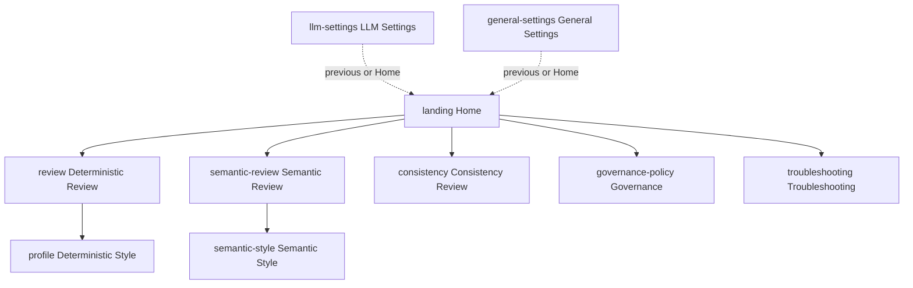

# Breadcrumb parent navigation — fix plan

Status: proposed (architect review)
Owner mode: code

## Problem

Every secondary page renders the shared [`Breadcrumb`](src/taskpane/shell/Breadcrumb.tsx:28)
control, but each page hardcodes its own `label` string and the destination is
supplied by a `back` closure that differs between the two dashboards in
[`Dashboard.tsx`](src/taskpane/pages/Dashboard.tsx:303). Two defects result:

1. **The label lies in the no-profile dashboard.** `DashboardWithoutProfile`'s
   `back` is [`navigate("landing")`](src/taskpane/pages/Dashboard.tsx:329), but six
   pages still label their control "Back to Deterministic Review". The user presses
   one label and arrives somewhere else — the exact defect
   [ADR-0102](docs/decision-log.md:3291) forbids ("a labelled control's destination
   is its label").
2. **Labels are hardcoded in nine files**, so the "one `ROUTES` source owns labels"
   rule ([ADR-0131](docs/decision-log.md:5340)) is not honoured by the breadcrumbs.

There is no parent map at all, so "navigate up one level" is undefined.

## Target parent map (confirmed)

The one level above a page, per the spec tree in
[`plans/unified-fluent-v9-ux-implementation-plan.md`](plans/unified-fluent-v9-ux-implementation-plan.md:263),
with groups collapsed to a page and each style page pointing at the review it serves:

| Route (key)         | Parent                       | Breadcrumb label                  |
| ------------------- | ---------------------------- | --------------------------------- |
| `landing`           | — (root)                     | no breadcrumb                     |
| `review`            | `landing`                    | Back to Home                      |
| `semantic-review`   | `landing`                    | Back to Home                      |
| `consistency`       | `landing`                    | Back to Home                      |
| `profile`           | `review`                     | Back to Deterministic Review      |
| `semantic-style`    | `semantic-review`            | Back to Semantic Review           |
| `governance-policy` | `landing`                    | Back to Home                      |
| `troubleshooting`   | `landing`                    | Back to Home                      |
| `llm-settings`      | `landing` (or previous page) | Back to Home / Back to <previous> |
| `general-settings`  | `landing` (or previous page) | Back to Home / Back to <previous> |

Assumption to confirm at implementation: `profile` (Deterministic Style) points at
`review` (Deterministic Review), mirroring `semantic-style` → `semantic-review`.
If it should instead sit directly under Home, change one entry in the map.



## Design

Label and destination become one value: the parent **route key**. The visible text
is derived from [`ROUTES`](src/taskpane/routes.ts:74), so a breadcrumb can no longer
say one thing and go somewhere else.

1. **`routes.ts` — the parent map.**
   - Add `PARENT_ROUTE: Record<TaskPaneDestination, TaskPaneDestination | null>`
     (`landing` → `null`).
   - Add pure `parentRoute(destination): TaskPaneDestination | null`.
   - Add pure `resolveParentDestination(current, previous): TaskPaneDestination | null`
     used for the settings "previous page" rule.
   - Add `isRoute(destination)` / label lookup helper if useful; labels already come
     from `ROUTES`.

2. **`Breadcrumb.tsx` — derive the label, remove free text.**
   - Replace `label: string` with `parent: TaskPaneDestination | null`.
   - Render `Back to {ROUTES label for parent}`; return `null` when `parent` is `null`.
   - The API change makes a contradictory label impossible by construction.

3. **Static pages — read their parent from the map.**
   One line each, `onBack` unchanged:
   - [`Profile.tsx`](src/taskpane/pages/Profile.tsx:54), [`ReviewWithoutProfile.tsx`](src/taskpane/pages/ReviewWithoutProfile.tsx:52),
     [`SemanticReview.tsx`](src/taskpane/pages/SemanticReview.tsx:486), [`ConsistencyReview.tsx`](src/taskpane/pages/ConsistencyReview.tsx:225),
     [`GovernancePolicy.tsx`](src/taskpane/pages/GovernancePolicy.tsx:45), [`DebuggingPanel.tsx`](src/taskpane/components/DebuggingPanel.tsx:277),
     [`SemanticStyle.tsx`](src/taskpane/pages/SemanticStyle.tsx:265):
     `<Breadcrumb parent={parentRoute("profile")} onBack={onBack} />` (own key).

4. **Settings pages — accept the resolved parent.**
   [`LlmSettings.tsx`](src/taskpane/pages/LlmSettings.tsx:20) and
   [`GeneralSettings.tsx`](src/taskpane/pages/GeneralSettings.tsx:26) gain
   `parent: TaskPaneDestination | null` and render
   `<Breadcrumb parent={parent} onBack={onBack} />`.

5. **`usePageNavigation` hook (new, shared) — previous-page tracking.**
   Both dashboards duplicate `navigate` and both need the same logic, so introduce
   [`src/taskpane/usePageNavigation.ts`](src/taskpane/usePageNavigation.ts:1):

   ```ts
   export function usePageNavigation(initial: TaskPaneDestination) {
     const [page, setPage] = useState(initial);
     const previousRef = useRef<TaskPaneDestination | null>(null);
     function navigate(destination: TaskPaneDestination): void {
       if (destination !== page) previousRef.current = page;
       setPage(destination);
     }
     const parent = resolveParentDestination(page, previousRef.current);
     function goToParent(): void {
       navigate(resolveParentDestination(page, previousRef.current));
     }
     return { page, navigate, parent, goToParent };
   }
   ```

   `resolveParentDestination` returns the previous page for the two settings routes
   when it is a real, non-settings page, otherwise the mapped parent (`landing`).
   This gives the settings breadcrumb "Back to <previous page>" when there is one and
   "Back to Home" otherwise.

6. **`Dashboard.tsx` — use the hook in both dashboards.**
   - Replace `const [page, setPage] = useState(...)` and the local `navigate` in
     [`DashboardWithoutProfile`](src/taskpane/pages/Dashboard.tsx:312) and
     [`DashboardWithProfile`](src/taskpane/pages/Dashboard.tsx:529) with the hook.
   - Route the direct `setPage` calls (arrival mapping at
     [`984`](src/taskpane/pages/Dashboard.tsx:984), and
     [`1926`](src/taskpane/pages/Dashboard.tsx:1926),
     [`1990`](src/taskpane/pages/Dashboard.tsx:1990),
     [`2073`](src/taskpane/pages/Dashboard.tsx:2073)) through `navigate` so the
     previous page is recorded for the settings breadcrumb.
   - Pass `parent={parent}` and `onBack={goToParent}` to `LlmSettings`/`GeneralSettings`;
     keep each page's existing `onBack` semantics for the other routes.
   - Delete the now-dead `back` closures and the long comment at
     [`402`-`425`](src/taskpane/pages/Dashboard.tsx:413) that justified a lie.

## Behaviour change to call out

The three review pages now return to **Home** (spec tree), not to Deterministic
Review. This inverts
[`DashboardNoProfile.test.tsx`](tests/unit/taskpane/pages/DashboardNoProfile.test.tsx:211),
whose test is literally named "returns from Semantic Review to Deterministic Review,
not to Home" — that test must be rewritten to assert the new parent.

## Tests

Update (labels change):

- [`activeGovernance.test.tsx`](tests/unit/taskpane/activeGovernance.test.tsx:166) — Governance → "Back to Home".
- [`ConsistencyReview.test.tsx`](tests/unit/taskpane/pages/ConsistencyReview.test.tsx:209) — → "Back to Home".
- [`DashboardNoProfile.test.tsx`](tests/unit/taskpane/pages/DashboardNoProfile.test.tsx:211) — rewrite to Semantic Review → Home.
- [`GeneralSettings.test.tsx`](tests/unit/taskpane/pages/GeneralSettings.test.tsx:60), [`LlmSettings.test.tsx`](tests/unit/taskpane/pages/LlmSettings.test.tsx:34) — label now Home (or previous).

Add:

- `tests/unit/taskpane/routes.test.ts` — `PARENT_ROUTE` covers every destination in
  `TASKPANE_DESTINATIONS`, points only at real destinations, and has `landing` `null`;
  `resolveParentDestination` returns previous page for settings when valid, else the
  mapped parent.
- `tests/unit/taskpane/shellPrimitives.test.tsx` (or a `Breadcrumb` test) — the label
  equals `Back to {parent label}`; `parent={null}` renders nothing.
- Dashboard breadcrumb navigation test (both dashboards) — pressing each page
  breadcrumb lands on its `PARENT_ROUTE`; on a settings page it lands on the previous
  page when one was visited, else Home.

## Docs

- New `ADR-0137` in [`docs/decision-log.md`](docs/decision-log.md:1): the parent map
  is the single source; a breadcrumb's label is its destination; settings return to
  the previous page or Home. Extends ADR-0102 and ADR-0131.
- [`docs/CHANGELOG.md`](docs/CHANGELOG.md:1) entry.
- [`docs/manual-verification.md`](docs/manual-verification.md:481): keep the Semantic
  Style step, add the review-pages-return-Home step and the settings-return-previous step.
- Note the change in [`ROADMAP.md`](ROADMAP.md:1) / [`docs/project-state.md`](docs/project-state.md:1)
  if the unified-UX phase tracks breadcrumb work.

## Verification

`npm run verify` (typecheck → lint → format → test → build → manifest) must pass.
No credential, persistence, or Office-boundary surface is touched; the change is
confined to `src/taskpane/` plus docs.
