# Disclosure unification: every bespoke disclosure → one Fluent v9 primitive

> **Revised after a verification pass.** v1 named only `.tf-collapsible` / `.tf-profile-*` /
> `.tf-bulk-add`. A `<details>` sweep found **five more native disclosures** outside those class
> families, plus four correctness issues (a dead identifier, a callback-signature mismatch, a
> Dashboard render guard, and shared CSS). All are folded in below.

## 0. Why this exists

Plan §11.4 (["Deferred items"](unified-fluent-v9-ux-implementation-plan.md:442)) deferred the
conversion because it is a behaviour-visible change, not a reskin. This plan does it now, in full,
and the target is the spec's own promise: [`DisclosurePanel`](../src/taskpane/components/common/DisclosurePanel.tsx:24)
documents itself as _"The one disclosure (spec §32)"_. Today it is not the one disclosure — the pane
has **six** native `<details>` beside it.

## 1. The inventory (this is the corrected finding)

| Group  | What it really is                                 | Members                                                                                                                                                                                                                                                                                                                                                                                                                                                                  |
| ------ | ------------------------------------------------- | ------------------------------------------------------------------------------------------------------------------------------------------------------------------------------------------------------------------------------------------------------------------------------------------------------------------------------------------------------------------------------------------------------------------------------------------------------------------------ |
| A      | Native `<details>` wearing the named classes      | [`ProfileSection`](../src/taskpane/components/ProfileSection.tsx:87), [`ProfileSubsection`](../src/taskpane/components/ProfileSubsection.tsx:60), [`SemanticProfileEditor.Section`](../src/taskpane/components/SemanticProfileEditor.tsx:212), [`TerminologyBulkAdd`](../src/taskpane/components/TerminologyBulkAdd.tsx:99)                                                                                                                                              |
| **A′** | **Native `<details>` outside the named classes**  | [`FindingDetail`](../src/taskpane/components/FindingDetail.tsx:293), [`ConsistencyReviewResults`](../src/taskpane/components/ConsistencyReviewResults.tsx:73) `WhyConfidence`, [`ConsistencyReviewResults`](../src/taskpane/components/ConsistencyReviewResults.tsx:265) `Checks performed`, [`ProfileEditor`](../src/taskpane/components/ProfileEditor.tsx:547) revision history, [`ProfileHistoryCompare`](../src/taskpane/components/ProfileHistoryCompare.tsx:54)    |
| B      | Controlled `Button` + `aria-expanded` disclosures | [`CoverageBanner`](../src/taskpane/components/CoverageBanner.tsx:157), [`ApplyResultBlock`](../src/taskpane/components/ApplyResultBlock.tsx:74), [`IgnoredFindings`](../src/taskpane/components/IgnoredFindings.tsx:59), [`Dashboard`](../src/taskpane/pages/Dashboard.tsx:1772) findings + pending, [`ProfileRecordSection`](../src/taskpane/components/ProfileRecordSection.tsx:213) trail, [`SemanticStyle`](../src/taskpane/pages/SemanticStyle.tsx:387) diagnostics |
| C      | Plain cards — **not disclosures at all**          | [`ReviewWithoutProfile`](../src/taskpane/pages/ReviewWithoutProfile.tsx:58), [`OpenRouterConnectionSettings`](../src/taskpane/components/OpenRouterConnectionSettings.tsx:200), [`LearnSemanticStyle`](../src/taskpane/components/semantic/LearnSemanticStyle.tsx:147), [`ProfileRecordSection`](../src/taskpane/components/ProfileRecordSection.tsx:130) outer section                                                                                                  |

**A′ is the gap.** It is not in the deferred sentence, but it is exactly what the deferred sentence is
about — a native disclosure that should be the shared primitive. Excluding it leaves the pane with six
native `<details>` and makes the "one disclosure" claim false. It is included; if you want it left
native, say so and item 9 is dropped.

## 2. The primitive (extend, do not add)

Fluent v9 `Accordion` (installed, `@fluentui/react-components@9.74.9`) already supports controlled
`openItems` / `onToggle`, `multiple`, and an `AccordionHeader` whose root slot can be a heading with a
real `button` inside. No new dependency; one primitive extended.

```ts
export interface DisclosurePanelProps {
  title: React.ReactNode; // visible header content
  headerSlot?: React.ReactNode; // right-aligned badge / count
  ariaLabel?: string; // when the visible title is not the full name
  id?: string; // header button id, for aria-labelledby / stable ids
  as?: "div" | "h2" | "h3" | "h4"; // heading wrapper; default div (matches the old <summary>)
  defaultOpen?: boolean; // uncontrolled initial; ignored when `open` is present
  open?: boolean; // present === controlled
  onToggle?: (open: boolean) => void;
  className?: string;
  children: React.ReactNode;
}
```

Implementation shape (respect `exactOptionalPropertyTypes` — spread, never pass `undefined`):

```tsx
const ITEM = "panel";
const controlled = open !== undefined;
<Accordion
  className={mergeClasses(styles.root, className)}
  collapsible
  {...(controlled
    ? { openItems: open ? [ITEM] : [], onToggle: (_e, d) => onToggle?.(d.openItems.length > 0) }
    : { defaultOpenItems: defaultOpen ? ITEM : undefined })}
>
  <AccordionItem value={ITEM}>
    <AccordionHeader
      as={as}
      {...(id ? { id } : {})}
      {...(ariaLabel ? { "aria-label": ariaLabel } : {})}
    >
      <span className={styles.headerContent}>
        {title}
        {headerSlot}
      </span>
    </AccordionHeader>
    <AccordionPanel>{children}</AccordionPanel>
  </AccordionItem>
</Accordion>;
```

Nested panels (`ProfileSubsection` in `ProfileSection`) are separate `Accordion` instances — contexts
do not collide, no `multiple` needed across them.

## 3. Migration map

```mermaid
flowchart TD
  A1[ProfileSection details] --> DP[DisclosurePanel]
  A2[ProfileSubsection details] --> DP
  A3[SemanticProfileEditor Section details] --> DP
  A4[TerminologyBulkAdd details] --> DP
  A5[FindingDetail details] --> DP
  A6[ConsistencyReviewResults WhyConfidence details] --> DP
  A7[ConsistencyReviewResults Checks performed details] --> DP
  A8[ProfileEditor revision history details] --> DP
  A9[ProfileHistoryCompare technical diff details] --> DP
  B1[CoverageBanner controlled] --> DP
  B2[ApplyResultBlock controlled] --> DP
  B3[IgnoredFindings controlled] --> DP
  B4[Dashboard findings and pending] --> DP
  B5[ProfileRecordSection trail] --> DP
  B6[SemanticStyle diagnostics] --> DP
  C1[ReviewWithoutProfile card] --> FC[Fluent Card]
  C2[OpenRouterConnectionSettings card] --> FC
  C3[LearnSemanticStyle card] --> FC
  C4[ProfileRecordSection outer card] --> FC
  DP --> RM[Delete residual CSS]
  FC --> RM
  RM --> TS[Rewrite pinned tests and add guards]
```



Per-consumer notes:

- **A1 ProfileSection** — `title` = section title, `headerSlot` = the `ToneBadge` marker when present,
  `id` = the section id (see §4 dead-identifier fix), `defaultOpen` passes through. Body keeps the
  summary `<p>`, the blocked note, the limits `<ul>`, and the fields wrapper (folded to Griffel).
- **A2 ProfileSubsection** — nested `DisclosurePanel`; indent / left-border becomes a Griffel class;
  `id` passes through.
- **A3 SemanticProfileEditor `Section`** — `title` = group title; body = summary `<p>` + inline row.
- **A4 TerminologyBulkAdd** — `title` = "Add many terms"; body unchanged, keeping `role="status"` and
  the `${id}-hint` / `${id}-summary` ids.
- **A5 FindingDetail** — `title` = "Details"; body = the two `<p>` lines. The `tf-finding-detail-region`
  class goes; its CSS (`168–181`) is deleted.
- **A6/A7 ConsistencyReviewResults** — `WhyConfidence` → `title` = `` `Why ${…}%?` ``; the bare
  `Checks performed` `<details>` → `DisclosurePanel`.
- **A8 ProfileEditor revision history** — `title` = "Revision history"; body = the `<ul>`. **`.tf-editor-note`
  stays**: two `<p>` elements ([`541`](../src/taskpane/components/ProfileEditor.tsx:541),
  [`577`](../src/taskpane/components/ProfileEditor.tsx:577)) share it, so only the `<details>` migrates.
- **A9 ProfileHistoryCompare** — `title` = "Technical field diff"; body = the `<pre>`.
- **B1/B2 CoverageBanner, ApplyResultBlock** — controlled. **Callback fix (§4.2):** their prop is
  `onToggle: () => void` and the parent passes `() => setX(open => !open)`; pass
  `onToggle={() => onToggle()}` to the `DisclosurePanel` so the existing `() => void` contract is
  unchanged. Keep the `open ? content : null` guard so a collapsed panel mounts nothing.
- **B3 IgnoredFindings** — controlled from its own `useState`; empty list still renders `null`.
- **B4 Dashboard findings + pending** — **behaviour change.** Today the panel renders only when open
  and a _different_ button appears when closed ([`1878`](../src/taskpane/pages/Dashboard.tsx:1878),
  [`2024`](../src/taskpane/pages/Dashboard.tsx:2024)). **Render the `DisclosurePanel` whenever
  `page === "review"`**, drop the `&& findingsOpen` guard and delete both sibling expand buttons.
  `findingsOpen` starts `true` and the navigation effects that set it stay valid.
- **B5 ProfileRecordSection trail** — controlled from `showAllRevisions`. **Label fix (§4.3):** keep
  `title={showAllRevisions ? "Hide revisions" : "Show all revisions"}` and the count in `headerSlot`.
- **B6 SemanticStyle diagnostics** — controlled from `diagnosticsOpen`; same label fix
  (`"Hide diagnostics"` / `"Show diagnostics"`).
- **C1–C4** — Fluent `Card`. **Verify `Card` accepts `as="section"`**; if it does not, keep the outer
  `<section aria-label=…>` and put the `Card` inside it, so the region semantics and `aria-label`
  survive. `ProfileRecordSection` is both: outer `Card`, inner trail `DisclosurePanel`.

## 4. Correctness fixes the first draft missed

1. **Dead identifier — `headingId`.** `ProfileSection`'s `headingId` (`${id}-heading`) and
   `ProfileSubsection`'s `${id}-heading` are referenced by nothing (only defined). Removing the span
   without routing the id leaves an unused local, which `noUnusedLocals` + `no-unused-vars` reject.
   **Route `id` into `DisclosurePanel`'s `id`** so the prop stays used and the DOM id is stable.
2. **Callback signature.** `CoverageBanner` / `ApplyResultBlock` declare `onToggle: () => void`.
   Calling it with an argument is a TS error; pass a no-arg lambda to `DisclosurePanel`.
3. **Label-switching disclosures.** The trail and diagnostics labels change with state; preserve them
   by computing `title` from `open`. Their tests match on `/Show all revisions/` and `/Show diagnostics/`.
4. **Shared CSS.** `.tf-editor-note` is used by two paragraphs as well as a `<details>` — keep it.
   `.tf-finding-detail-region` is used only by the two migrating `<details>` — delete it.
5. **eslint/Griffel.** `no-restricted-syntax` bans hex/rgba literals and literal `fontSize`,
   `font-weight`, `line-height`, and inline `style` objects for those. The CSS→Griffel fold must use
   Fluent `tokens.*` (`tokens.spacingVerticalS`, `tokens.colorNeutralStroke1`, `tokens.fontWeightSemibold`),
   never raw values.
6. **Heading level.** The old `<summary>` had no heading role; `AccordionHeader` can. Default `as="div"`
   to avoid disturbing the outline, and override per surface only where a heading is wanted.

## 5. CSS to delete from [`taskpane.css`](../src/taskpane/taskpane.css:1)

Named set: `.tf-collapsible` (1058), `.tf-collapsible-header` (1082) + `.tf-collapsible-header span`
(1094), `.tf-profile-section` (703), `-summary` (710), `-body` (720), `-fields` (724), `-title` (731),
`.tf-profile-subsection` (744), `-summary` (750), `-title` (755), `[open] > …` (761), `-body` (765),
`.tf-bulk-add` (777), `-summary` (781), `[open] > …` (788), `-body` (792), `-skipped` (796),
`.tf-profile-section-limits` (803).

A′ additions: `.tf-finding-detail-region` (168) + `> summary` (174) + `> p` (179).

**Keep:** `.tf-editor-note` (436) — still used by two paragraphs.

Verify every deleted selector is unreferenced before removing; anything still used moves to a Griffel
`makeStyles` block.

## 6. Tests

Pinned to the old DOM and rewritten (~26 assertions across 8 files):

- [`DeterministicStyleSections.test.tsx`](../tests/unit/taskpane/components/DeterministicStyleSections.test.tsx:120) —
  `sectionFrames` / `subSectionsOf` / `subSections` / `groupTitled` / `marker.closest("details")`.
  Re-express as behaviour: 4 section disclosures by name, the Language section's 7 groups by name, one
  group open by default.
- [`ProfileEditor.test.tsx`](../tests/unit/taskpane/components/ProfileEditor.test.tsx:308) — opens
  `details.tf-bulk-add` by `.open = true`; click the header instead.
- [`terminologyBulkAdd.test.tsx`](../tests/unit/taskpane/components/terminologyBulkAdd.test.tsx:53) —
  `renderOpened` uses `.open = true`; click the header instead.
- [`findingDetailVariants.test.tsx`](../tests/unit/taskpane/components/findingDetailVariants.test.tsx:65) —
  `.tf-finding-detail-region` presence / absence (A5).
- [`PhaseCComponents.test.tsx`](../tests/unit/taskpane/components/PhaseCComponents.test.tsx:103) —
  `.tf-finding-detail-region` count = 2 (A5/A6).
- [`ProfileHistoryCompare.test.tsx`](../tests/unit/taskpane/components/ProfileHistoryCompare.test.tsx:25) —
  `getByText("Technical field diff")` (A9).

Verify (likely already green — they use `getByRole` + `aria-expanded`, and the migrated header is a real
button): [`ApplyResultBlock.test.tsx`](../tests/unit/taskpane/components/ApplyResultBlock.test.tsx:270),
[`findingsListIntegrity.test.tsx`](../tests/unit/taskpane/components/findingsListIntegrity.test.tsx:180),
[`ProfileRecordSection.test.tsx`](../tests/unit/taskpane/components/ProfileRecordSection.test.tsx:167).

New tests:

- `tests/unit/taskpane/components/DisclosurePanel.test.tsx` — the primitive's own check: uncontrolled
  default-open, controlled `open` / `onToggle` round-trip, `headerSlot` rendered, nested panels toggle
  independently, `open`-gated children stay unmounted when collapsed.
- **Guard test** — no native `<details>` or `<summary>` remains in any `src/taskpane/**/*.tsx`, and none
  of the retired class names appear in any `src/**/*.tsx` or in `taskpane.css`. This is the invariant
  that fails if the migration is left half-done.

## 7. Docs to update

- [`plans/unified-fluent-v9-ux-implementation-plan.md`](unified-fluent-v9-ux-implementation-plan.md:446) —
  remove the deferred bullet.
- [`docs/decision-log.md`](../docs/decision-log.md:5259) — extend ADR-0130 (Fluent v8 → v9) or add a new
  ADR: the pane has exactly one disclosure and one card; the two Dashboard mount/unmount swaps became
  in-place disclosures; six native `<details>` were retired.
- [`docs/project-state.md`](../docs/project-state.md:1) and [`ROADMAP.md`](../ROADMAP.md:236) — record it
  under the unified Fluent v9 UX migration.

## 8. Verification and definition of done

- `npm run verify` — the full ordered graph (typecheck → lint → format → … → package-check) green.
  `typecheck` covers `noUnusedLocals` / `noUnusedParameters`, and `lint --max-warnings 0` covers
  `no-unused-vars`: **no dead identifier, prop, or helper may survive.**
- Manual grep for orphaned helpers after the last consumer is edited (e.g. anything that only fed a
  deleted button).
- The visual result and screen-reader behaviour remain human evidence in a real Word host
  ([`docs/manual-verification.md`](../docs/manual-verification.md:1)); a green automated run is not a
  release (ADR-0051).

## 9. Risks

- **Behaviour-visible, not a reskin** (plan §11.4). Group B keeps its controlled contract; B4 changes
  from mount/unmount to one persistent header.
- **`AccordionPanel` keeps children mounted.** Preserve the `open ? content : null` guard wherever a
  test asserts absence.
- **`exactOptionalPropertyTypes`** — spread optional props; never pass `undefined`.
- **Fluent `Card` polymorphism** — confirm `as="section"`; fall back to a wrapping `<section>`.
- **Heading outline** — default `as="div"`; pick a level per surface only where warranted.
