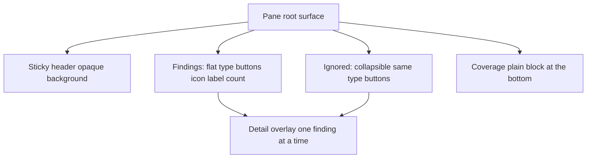

# Flatten the pane, and review one finding at a time

## The problem, confirmed

The user's observation is correct: on Deterministic Review, content sits inside a
box, inside another box, inside a third. Compared with Word's own Editor
proofing pane, ToneForge wastes the pane's width and height on container chrome.

### The exact nesting on the review page

```
AppShell → main → PageContainer        flex column, root surface
  └─ TaskPaneHeader                    position sticky, but NO background
  └─ Breadcrumb
  └─ DisclosurePanel Findings          BOX 1  border + radius + tinted fill
       └─ p summary, FindingsToolbar
       └─ FindingsList section
            └─ h3, div role=listbox
                 └─ FindingGroupCard article   BOX 2  border-left + padding-left
                      └─ div role=listbox
                           └─ FindingCard option  BOX 3
                 └─ FindingCard option            BOX 3
  └─ CoverageBanner                    BOX  border + radius + tinted fill
       └─ .tf-coverage detail          BOX inside BOX  (a second border/fill)
  └─ ApplyResultBlock                  BOX  border + radius + tinted fill
  └─ IgnoredFindings                   BOX  border + radius + tinted fill
```

### The root cause is a copy-pasted style object

Ten components each define the **same** `styles.root` and hand it to
`DisclosurePanel` as a `className`:

```ts
// identical in all ten
root: {
  marginTop: tokens.spacingVerticalM,
  border: `${tokens.strokeWidthThin} solid ${tokens.colorNeutralStroke1}`,
  borderRadius: tokens.borderRadiusMedium,
  backgroundColor: tokens.colorNeutralBackground2, // or Background1
  overflow: "hidden",
}
```

Call sites: [`Dashboard.tsx`](../src/taskpane/pages/Dashboard.tsx:112) Findings,
[`CoverageBanner.tsx`](../src/taskpane/components/CoverageBanner.tsx:116),
`ApplyResultBlock.tsx` (removed, ADR-0141),
[`IgnoredFindings.tsx`](../src/taskpane/components/IgnoredFindings.tsx:27),
[`ProfileSection.tsx`](../src/taskpane/components/ProfileSection.tsx:27),
[`ProfileRecordSection.tsx`](../src/taskpane/components/ProfileRecordSection.tsx:36),
[`SemanticProfileEditor.tsx`](../src/taskpane/components/SemanticProfileEditor.tsx:216),
[`LearnSemanticStyle.tsx`](../src/taskpane/components/semantic/LearnSemanticStyle.tsx:43),
[`OpenRouterConnectionSettings.tsx`](../src/taskpane/components/OpenRouterConnectionSettings.tsx:64),
[`ReviewWithoutProfile.tsx`](../src/taskpane/pages/ReviewWithoutProfile.tsx:38).

A **recurring regression**: [`AppShell.tsx`](../src/taskpane/shell/AppShell.tsx:31)
and [`CoverageBanner.tsx`](../src/taskpane/components/CoverageBanner.tsx:122) both
record earlier single-instance fixes of the same symptom. The durable fix is one
shared border-less surface rule.

## The target

Modelled directly on Word's Editor proofing pane.

### Findings list — flat, all rows on one level

- One **button row** per type group: **icon, label, count**.
- The rows are **buttons, not collapsible headings**. There is no disclosure per
  group and no nesting — every type row sits at the same visible level.
- Pressing a row opens the one-finding-at-a-time overlay for that type.

```
Findings
┌─────────────────────────────────────────┐
│  Spelling                          5    │   each row is a button
├─────────────────────────────────────────┤
│  Grammar                           1    │
├─────────────────────────────────────────┤
│  Clarity                           3    │
└─────────────────────────────────────────┘
```

### Detail overlay — one finding at a time

- **Sticky header with a background**: close `×`, `N remaining`, `‹ ›` arrows.
  The header stays put and is opaque, so the finding beneath it scrolls under it.
- Body: the finding — type, message, quoted text with the flagged span marked,
  actual → expected, location.
- Actions: **Accept**, **Accept all of this type**, **Skip**, **Ignore**.

```
┌─────────────────────────────────────────┐
│  ×        5 remaining           ‹   ›   │   sticky, opaque
├─────────────────────────────────────────┤
│  Spelling                                │
│  Not in Dictionary                       │
│                                          │
│  When, while the lovely valley teems     │
│  with vapour around me ...               │
│                                          │
│  vapour → vapor                          │
├─────────────────────────────────────────┤
│  Accept   Accept all of this type        │
│  Skip     Ignore                         │
└─────────────────────────────────────────┘
```

- **Accept** applies that one change in the text immediately (tracked), then
  advances to the next finding of the type.
- **Accept all of this type** applies every change in the group in one plan, then
  closes the overlay.
- **Skip** advances without applying; the finding stays in the list.
- **Ignore** moves the finding to the Ignored list, then advances.
- **Arrows** step through the group's findings; `N remaining` counts the group's
  undecided findings.

### Ignored findings — collapsible, same structure

- A collapsible section (de-boxed), holding the **same type-button structure** as
  the live findings, built from the ignored entries.
- Pressing a type row opens the same overlay for the ignored findings of that
  type, where the action is **Restore** rather than Accept.

### Sticky header gets a background

[`.tf-app-header`](../src/taskpane/taskpane.css:800) is already
`position: sticky`, but it is `transparent` by design. Give it an opaque
`var(--tf-surface)` background so content scrolling underneath does not bleed
through, and keep the bottom rule as its only edge.

### Apply result block — removed

Each Accept applies in text straight away, so there is no batch to report. The
block is dropped from the review page.

## Hierarchy



## How Accept applies immediately, reusing what exists

No new mutation path:

1. [`reviewFinding`](../src/taskpane/reviewGate.ts:108) confirms the finding has a
   change, resolved by occurrence identity so the observer's finding and the
   preview's change line up.
2. The one-change plan is the preview plan narrowed to that change — the same
   narrowing [`reviewedPlan`](../src/taskpane/reviewGate.ts:192) performs.
   **Accept all of this type** narrows it to every change belonging to the type's
   findings instead of one.
3. [`applyReviewedPlan`](../src/reformat/orchestrator.ts:840) applies it — still
   the only mutation path.
4. The observer's `onDocumentChanged()` re-scans, and the applied change is
   **not** re-reported because the reviewed-text read reads the accept-all view
   (already landed). This is the load-bearing enabler.

The coverage gate is kept: Accept is disabled with the same reason when coverage
is incomplete.

## Design decisions

1. **Boxes go away entirely on the review page.** The pane background is the
   surface.
2. **Type groups are buttons, all at one level.** No disclosure per group.
3. **One `.tf-section` rule** in [`taskpane.css`](../src/taskpane/taskpane.css) is
   the anti-regression convention; the other six call sites adopt it.
4. **Overlay, not a route** — a Fluent v9 overlay within the pane, so navigation
   and the list underneath are untouched.
5. **The overlay steps within the opened type.** `N remaining` counts that type,
   matching the Editor's "5 remaining" under Spelling.
6. **Grouping is by type**, keyed on `ruleId` with a `category` fallback —
   already built and tested in [`findingsByType.ts`](../src/taskpane/findingsByType.ts).
7. **Pending Changes is removed from this page.** Immediate apply leaves nothing
   to accumulate; the apply pipeline and review gate stay.

## Change list

### A. Sticky header background

- Add an opaque `var(--tf-surface)` background to `.tf-app-header`
  ([`taskpane.css`](../src/taskpane/taskpane.css:800)) and correct its comment,
  which currently says it has no background on purpose.

### B. One surface rule

- Add a border-less `.tf-section` to [`taskpane.css`](../src/taskpane/taskpane.css):
  vertical rhythm and an optional top divider, no border, no fill, no radius.
- Repoint the ten `styles.root` definitions at it.

### C. Flat findings list

- New `FindingTypeList` component: flat button rows (icon, label, count) from
  `projectFindingsByType`, each opening the overlay. Reused by the live list and
  by the Ignored section.
- Retire `FindingGroupCard` and the per-finding `FindingCard` in the list; delete
  the `.tf-finding-group` `border-left` rule
  ([`taskpane.css`](../src/taskpane/taskpane.css:131)).

### D. Detail overlay

- New component: sticky header with close, `N remaining`, prev/next; body reusing
  [`FindingDetail`](../src/taskpane/components/FindingDetail.tsx); actions Accept,
  Accept all of this type, Skip, Ignore.
- Accept narrows the preview plan to one change and calls `applyReviewedPlan`,
  then advances. Accept-all narrows to the type's changes.
- De-box the nested Details panel in
  [`FindingDetail.tsx`](../src/taskpane/components/FindingDetail.tsx:115).

### E. Ignored section

- Rebuild [`IgnoredFindings`](../src/taskpane/components/IgnoredFindings.tsx) on
  the same type-button structure, de-boxed, with Restore in the overlay.

### F. Remove and reorder

- Drop `ApplyResultBlock` and the `PendingChanges` section from the review page.
- Move `CoverageBanner` to the bottom, under Ignored; de-box it.

### G. Guardrails

- Test: an applied finding does not reappear after the post-accept rescan.
- Test: Accept-all applies every change of the type in one plan.
- Test: review sections carry no box style.
- Update [`docs/ux-state-matrix.md`](../docs/ux-state-matrix.md); record one ADR
  for the single-surface rule and one for immediate apply.

## Out of scope for this pass

Stepping across all types in one overlay, and auto-scan tuning. Auto-scan on load
stays as it is until this lands.

## Verification

`npm run verify` must pass (typecheck, lint, format, tests, build, manifest).
The manual Word-host gate in [`docs/manual-verification.md`](../docs/manual-verification.md)
remains the only evidence for the host gate.
