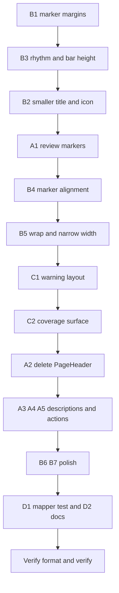

# Pane Header — deterministic peer review and cleanup plan

Peer review of the delivered pane-header refactor against
[`pane-header-system-implementation-plan.md`](plans/pane-header-system-implementation-plan.md),
with a measured height budget and a prioritised cleanup plan. The verification
state is green (`npm run verify` passes all thirteen automated stages;
`word-host-evidence` pending) and every step below is scoped to keep it green.

## 1. Verdict on design alignment

The core design is delivered and correct:

- Four levels `landing`, `review`, `workspace`, `utility` exist and match §5.2.
- One layout, one component, level selects the icon only (§5.2) — correct.
- Deterministic Review, Semantic Review and Consistency Review are all peers on
  the `review` level (§5.2, the owner's correction) — correct.
- Styling is Fluent v9 `makeStyles` + `mergeClasses` + `tokens`, no bespoke
  class system and no new colour literals (§5.4) — correct.
- `.tf-brand-lockup` / `.tf-active-profile` are deleted, not renamed (§5.4) —
  correct.
- `title` is `routeLabel(page)` (§5.3 rule 1) — correct.
- The warning is `role="note"`, never a live region (§5.8 invariant 5) — correct.
- Narrow-pane label hiding keeps the `<dt>` in the DOM (§5.7/§5.8) — correct.

Four alignment gaps and several visual defects remain; the two worst are A1 (a
missing flagship fact) and B1 (the height/padding defect the eye sees first).

## 2. Issues, evidence, recommendation

### P1 — Alignment with the plan

**A1. The flagship review header is missing two required markers.**
`ReviewHeaderInput.lastScan` is declared at
[`headerMarkers.ts:48`](src/taskpane/shell/headerMarkers.ts:48) and passed from
[`Dashboard.tsx:366`](src/taskpane/pages/Dashboard.tsx:366), but
[`reviewHeaderMarkers()`](src/taskpane/shell/headerMarkers.ts:239) never reads it.
The plan §6.2 flagship requires a `Last scan` marker ("never" when nothing has
been scanned) and a `Scope` marker built from `scopeLabel` (§6.2). Neither is
rendered, so the review surface shows status, open counts and style but not the
timestamp or the examined scope — two of the facts the brief named. This _adds_
information and must not add height (see §3: keep the strip on one line).
_Recommendation:_ add both markers in `reviewHeaderMarkers` in §6.2 order
(severity, then `Last scan`, then `Scope`, then `Style`); format the ISO
timestamp once; unit-test `never` and the empty scope.

**A2. `PageHeader.tsx` was duplicated, not evolved in place.**
Plan §5.1 and §8 Phase 1 say "rename `PageHeader.tsx` → `PaneHeader.tsx` (not
duplicated)". The deliverable added a new
[`PaneHeader.tsx`](src/taskpane/shell/PaneHeader.tsx:179) and left
`PageHeader.tsx` (since deleted) orphaned — still
exported at [`shell/index.ts:10`](src/taskpane/shell/index.ts:10), imported by
nothing. It is a divergent twin: its h1 is `size={600}` (24px) against
PaneHeader's `size={500}` (20px). _Recommendation:_ delete `PageHeader.tsx` and
its export once no import remains.

**A3. Long intros live in the header instead of the body.**
Plan §8 Phase 5 says long intros become the first `Section` description and only
short intros become the header `description`. The delivered headers pass ~150
chars for Semantic Review ([`Dashboard.tsx:383`](src/taskpane/pages/Dashboard.tsx:383))
and ~300 chars for Deterministic Style ([`Dashboard.tsx:410`](src/taskpane/pages/Dashboard.tsx:410)).
§5.6 forces a single ellipsised line, so the text is clipped to a fragment that
conveys little — and it costs a full row of height. _Recommendation:_ one clause
in the header; the long text moves into the page body's first `Section`.

**A4. The review level carries a `description` at all.**
§5.2/§7.2 populate review slots as title, status, facts, freshness, actions — no
description. _Recommendation:_ drop it (and with it ~28px of height) or update §7.

**A5. Contextual actions are unfulfilled.**
§6.1/§7.2 give every review pane header actions (`Re-scan`, `Preview changes`),
but no `PaneHeader` call in
[`Dashboard.tsx`](src/taskpane/pages/Dashboard.tsx:314) passes `actions`; the
actions live in the page bodies instead. This keeps the header slim, so it is
not urgent — but §6.1 should be corrected to match, or the actions wired.
_Recommendation:_ correct §6.1 (page-body actions are the delivered design).

### P2 — Height, padding, and rhythm (the slim-header brief)

**B1. The marker strip has no user-agent margin reset — this is the padding the
brief is reacting to.**
`<dl>`/`<dt>`/`<dd>` are hand-styled raw elements; their Griffel classes set
only colour, overflow, `white-space` and `max-width`
([`PaneHeader.tsx:61`](src/taskpane/shell/PaneHeader.tsx:61)). No `margin: 0`
reset exists: the stylesheet resets only `body`
([`taskpane.css:79`](src/taskpane/taskpane.css:79)) and one unrelated list
([`taskpane.css:270`](src/taskpane/taskpane.css:270)). In WebView2 (Chromium) the
UA rules `dl { margin-block: 1em }` and `dd { margin-inline-start: 40px }`
therefore apply. Net effect: the strip carries ~16px of dead space above and
below, and each value floats ~44px from its label (`gap: 4px` + 40px). This is
the largest single contributor to the header's excessive height. _Measurement
caveat:_ jsdom computes no layout, so this is a deterministic UA-default
outcome, to be confirmed at the manual gate.
_Recommendation:_ `margin: 0` on `markers`, `markerLabel`, `markerValue`.

**B2. Title and icon are one step too large for a sticky bar.**
The title is `Text size={500}` (20px / 28px line) at
[`PaneHeader.tsx:197`](src/taskpane/shell/PaneHeader.tsx:197) and the icon is
20px at [`PaneHeader.tsx:196`](src/taskpane/shell/PaneHeader.tsx:196).
_Recommendation:_ title `size={400}` (16px / 22px line) and icon `fontSize={16}`.
The size the row is measured against is the title's line box (28px → 22px, −6px);
the icon shrinks for weight and, once the line box is 22px, still centres cleanly.
Record the deliberate departure from `--tf-font-title: 21px`
([`taskpane.css:37`](src/taskpane/taskpane.css:37)): the pane title is a sticky
label, not the page hero, and the ramp continues to govern in-page headings.

**B3. Vertical rhythm is too generous.**
The root gap is `spacingVerticalS` (8px) at
[`PaneHeader.tsx:26`](src/taskpane/shell/PaneHeader.tsx:26) and the bar is padded
`8px 0 12px` with `min-height: 56px` at
[`taskpane.css:814`](src/taskpane/taskpane.css:814).
_Recommendation:_ root gap `spacingVerticalXS` (4px); bar padding `6px 0`;
`min-height: 40px` (still clears the 32px nav button). Keep the header, not a
constant, defining the bar height.

**B4. Marker labels and pill values do not share a baseline.**
The labels pass as raw `<dt>`/`<dd>` ([`PaneHeader.tsx:223`](src/taskpane/shell/PaneHeader.tsx:223)),
so their line box is inherited (≈20–24px) while the Fluent `Badge` is a fixed
20px tall with `padding: 0 6px` and `caption1Strong` (12px / 16px)
(`node_modules/@fluentui/react-badge/lib/components/Badge/useBadgeStyles.styles.raw.js`).
`align-items: center` should centre them, but two different line boxes make the
alignment fragile and the pill looks tight against its own text.
_Recommendation:_ render the label and value through Fluent `Text` (size 300)
or pin `line-height: 20px` on both, set `.marker { alignItems: "center" }`
(already) and add a small `columnGap`; do **not** add a bespoke pill class
(§5.4). If the pill genuinely needs more internal padding, raise the Fluent badge
token once for the whole app (consistency), not in `PaneHeader`.

**B5. Narrow-pane wrap order differs from §5.7, and is unbounded.**
§5.7 says actions drop below the marker strip and the strip becomes a scrolling
single line below 260px; the delivered `row` is one `flex-wrap` container
([`PaneHeader.tsx:27`](src/taskpane/shell/PaneHeader.tsx:27)) and the strip wraps
to as many lines as it needs. Combined with B1, wrapping is the second-largest
height contributor at small widths. _Recommendation:_ decide and document the
rule. Proposed: keep `flex-wrap` (no hidden scroll), hide labels below **300px**
(raise it from 260px at [`PaneHeader.tsx:89`](src/taskpane/shell/PaneHeader.tsx:89))
so the values fit one line sooner, and cap the visible marker count per level so
the strip never exceeds two lines. Then correct §5.7 to match.

**B6. The heading icon adds a third accent.**
§5.4 says the header adds no custom colour; the icon is
`colorBrandForeground1` ([`PaneHeader.tsx:42`](src/taskpane/shell/PaneHeader.tsx:42)).
_Recommendation:_ recolour to `colorNeutralForeground2`, or keep brand at 16px
and note it. (The owner has confirmed the icon is wanted; this is a weight
question, not a removal.)

**B7. The status badge's `tone` is accepted and ignored.**
`PaneHeaderProps.status.tone` is declared at
[`PaneHeader.tsx:124`](src/taskpane/shell/PaneHeader.tsx:124) but
[`PaneHeader`](src/taskpane/shell/PaneHeader.tsx:208) renders
`<StatusBadge status={status.label} />` and drops it.
_Recommendation:_ honour it via `ToneBadge`, or remove the field.

### P2 — Notification items (internal spacing)

**C1. The header warning uses Fluent's single-line default, with less vertical
than horizontal padding.**
Fluent `MessageBar` is single-line by default: `minHeight: 36px`,
`alignItems: center`, `paddingLeft: spacingHorizontalM`, body
`paddingRight: spacingHorizontalM`, no vertical padding
(`node_modules/@fluentui/react-message-bar/lib/components/MessageBar/useMessageBarStyles.styles.raw.js`).
Text sits ~8px from the top and bottom but 12px from the sides, and the long
bodies (Troubleshooting's list, General Settings' `hostReadinessMessage`) depend
on ResizeObserver reflow to multiline — a path jsdom does not exercise.
_Recommendation:_ `layout="multiline"` on the header warning (applies
`paddingTop: spacingVerticalMNudge` and wraps), and confirm the box reads
balanced at the manual gate.

**C2. `CoverageBanner` paints a box inside a box.**
After the disclosure unification (P15, ADR-0136) the banner still passes its own
bordered surface as the `Accordion` className
([`CoverageBanner.tsx:172`](src/taskpane/components/CoverageBanner.tsx:172))
**and** renders an inner `
` with its own border,
`margin-top: 1rem` and `padding: 0.75rem`
([`taskpane.css:577`](src/taskpane/taskpane.css:577)). Inside `AccordionPanel`
that is a second border plus compounding padding around the same text.
_Recommendation:_ drop the inner border/background; keep only the verdict border
on the panel.

### P3 — Verification and documentation hygiene

- **D1.** `tests/unit/taskpane/shell/headerMarkers.test.ts` is named by §8 Phase 1
  and does not exist; the mapper's `never` / "No open findings" / "Unavailable"
  strings are covered only incidentally. Add it.
- **D2.** §7 markup shows the nav trigger inside the pane-header row; the
  delivered bar is a two-column grid with the trigger as column 1
  ([`taskpane.css:804`](src/taskpane/taskpane.css:804)). Correct §7 and the
  `PageHeader` references alongside A2.
- **D3.** `CoverageBanner` ([`CoverageBanner.tsx:189`](src/taskpane/components/CoverageBanner.tsx:189))
  and several page bodies use `role="status"`. ADR-0062's rule is per tick and
  the header correctly adds none; note as a separate audit, not a defect here.

## 3. Header height budget (computed, to confirm at the manual gate)

jsdom computes no layout, so these are derived from the box model and the Fluent
token values below — deterministic, but to be confirmed in Word. All figures are
vertical pixels from the top of the sticky bar to the first page element,
including the bar's `margin-bottom: 16px` and `border-bottom: 1px`.

Token values used: `fontSizeBase400 = 16px / lineHeightBase400 = 22px`;
`fontSizeBase500 = 20px / lineHeightBase500 = 28px`;
`fontSizeBase300 = 14px / lineHeightBase300 = 20px`;
Fluent `Badge` medium `height: 20px`; `spacingVerticalXS = 4px`,
`spacingVerticalS = 8px`.

### Current (Deterministic Review, 445px pane)

| Segment                         | Height  | Note                                        |
| ------------------------------- | ------- | ------------------------------------------- |
| Bar padding (8 top + 12 bottom) | 20      | `min-height: 56px` does not bind            |
| Title row (title line box 28px) | 28      | icon 20 < 28; status badge 20               |
| Root gap                        | 8       |                                             |
| Description (size 300)          | 20      |                                             |
| Root gap                        | 8       |                                             |
| `<dl>` UA margin-top            | 16      | absent from the stylesheet                  |
| Marker line (badge 20)          | 20      | 3 labelled markers wrap to 2 lines at 445px |
| Marker line 2                   | 20      |                                             |
| `<dl>` UA margin-bottom         | 16      |                                             |
| Border + margin-bottom          | 17      |                                             |
| **Total**                       | **173** | vs the old brand bar's 56px                 |

### Target after the B-series fixes

| Width / pane                            | Target total | How                                              |
| --------------------------------------- | ------------ | ------------------------------------------------ |
| ≥360px, markers on one line             | **≤ 76px**   | 22 line + 4 gap + 20 strip + 12 bar padding + 17 |
| ≥360px, markers on two lines            | **≤ 96px**   | one extra 20px marker line                       |
| utility (title only, warning absent)    | **56–64px**  | row 22 + padding 12 + 17; `min-height: 40px`     |
| <300px (labels hidden, strip ≤ 2 lines) | **≤ 96px**   | labels hidden, values one line sooner            |

Savings that get there: remove `<dl>` UA margins (**−32**), root gap 8→4
(**−8**), title 28→22 line (**−6**), drop the review/workspace description
(**−28**), bar padding 20→12 (**−8**). A1's two new markers are added **without**
height by fitting the strip on one line (labels hidden sooner, count capped).

### 3.2 The C-series revision — the strip is content-sized, and the pill is sized

The B-series budget above was written against a strip **capped at two lines**.
That cap is removed, and the heading row is re-sized, so the budget is restated
rather than amended in place.

| Change       | Was                                    | Now                             | Why                                                                                                                                |
| ------------ | -------------------------------------- | ------------------------------- | ---------------------------------------------------------------------------------------------------------------------------------- |
| Strip height | `max-height: 44px`, `overflow: hidden` | content-sized                   | A third row used to be clipped mid-pill. The header now grows to fit the rows it needs, so no pill is ever cut.                    |
| Label width  | `max-width: 50%`                       | `flex-shrink: 0`, no cap        | The percentage resolved against the strip's shrink-to-fit width, so a label was truncated by how much room its _own_ value needed. |
| Label hiding | `@media (max-width: 300px)`            | `@container (max-width: 370px)` | A docked pane's strip is narrower than the window, so a viewport query fired late and let the strip wrap to three rows first.      |
| Heading pill | `Badge` medium (20px, 12px icon)       | `Badge` large (24px, 16px icon) | The default size could not house its own icon beside a status word.                                                                |
| Heading row  | title's 22px line box                  | 24px, matching the pill         | The pill and the title text now share one line and one centre.                                                                     |
| Title margin | ramp's `0 0 12px`                      | `0`                             | Inside a flex row that margin is not breathing room — it lifted the title 12px off the pill's centre line.                         |
| Nav trigger  | `Button` medium (32px)                 | `Button` small (24px)           | A 32px trigger beside a 24px title row read as a second, larger target.                                                            |

The height cost is honest and bounded: the heading row goes from 22px to 24px
(**+2**), and the strip is no longer capped, so a pane whose markers genuinely
need three rows pays 20px for the third. What it buys is that **nothing is
clipped** — the previous cap hid the tail of a wrapped pill, and a half-shown
pill is worse than a taller header. The label-hide rule at 370px is what keeps
the common case at two rows: hiding the labels buys back the room the labels
themselves were taking.

Confirmed at the manual gate, not here: jsdom computes no layout, so the row
counts above are derived from the box model and the Fluent token values, and the
370px threshold is the width at which a fully-loaded review strip stops fitting
its labels and values on one line. Both need a real Word host at a real docked
width (ADR-0051).

### 3.1 Can it go slimmer than the target?

Yes — by collapsing the two zones (title row and marker strip) into **one row**
when the width allows, rather than shaving padding. Three tiers:

| Tier                      | Geometry                                                                                     | Height (≥380px) | Height (320–380px) | Reads as                            |
| ------------------------- | -------------------------------------------------------------------------------------------- | --------------- | ------------------ | ----------------------------------- |
| **Compact (recommended)** | one `flex` row: title left, status + markers right; `flexWrap` to two rows only when it must | **~45px**       | ~67px              | a normal compact app header         |
| **Comfortable**           | two stacked rows: title row, then the marker strip (the baseline plan)                       | ~76px           | ~76px              | roomy, never re-flows zones         |
| **Floor**                 | two rows, padding cut to 2px and margin to 8px                                               | ~63px           | ~63px              | cramped; the title touches the edge |

The compact tier is the same height as the old brand bar (56px) while carrying
the title, the status badge, and up to three markers — it is the slimmest shape
that keeps a comfortable 6–8px of padding. Its cost is honest and bounded: below
~380px the title and the strip stop sharing a line and the header falls back to
the two-row 67px shape. That is still slimmer than the comfortable tier, and it
re-flows on width rather than on content, so it does not oscillate.

**The floor is not worth taking.** Three hard limits decide it:

1. A heading below 16px stops reading as a heading and becomes a body label — so
   the row cannot go below a 22px line box without losing the visual hierarchy
   the header exists to create.
2. Under ~4px per side the title's cap-height sits against the top edge and the
   bottom border; the row starts to look clipped rather than compact.
3. Under ~12px beneath the bar the header welds to the first content element and
   stops reading as a separate sticky zone.

So the last ~9px between the 76px target and the ~67px floor is precisely the
breathing room the brief asked to keep. The compact tier is the way to go
noticeably slimmer **without** spending it: it removes a whole row instead of
trimming the padding inside rows. Recommendation: **adopt the compact tier**, and
keep `layout="multiline"` and the 4px gaps from the B-series.

## 4. Prioritised order of work

The B-series (height) first because it is what the brief is about, then A1 (the
missing fact, added at no height cost), then the notification fixes, then
alignment and hygiene. Every step leaves the suite green.

## 5. Definition of done for the cleanup

- The review header shows `Last scan` and `Scope`, and still fits one marker
  line at ≥360px.
- The marker strip has no UA margin: values sit `spacingHorizontalXS` from their
  labels; the strip adds no block margin; labels and pills share a 20px line box.
- The title is `size={400}`, the icon is 16px, and the deliberate departure from
  the 21px ramp is recorded.
- The bar totals ≤76px with markers on one line and ≤96px on two; utility panes
  ≤64px.
- The header warning wraps and is padded evenly; confirmed in Word at 329px and
  in both themes.
- `CoverageBanner` renders one surface; the review/workspace descriptions are one
  clause.
- `PageHeader.tsx` is gone; `headerMarkers.test.ts` exists.
- `npm run verify` still passes all thirteen stages; `word-host-evidence` remains
  the only open gate (ADR-0051).
