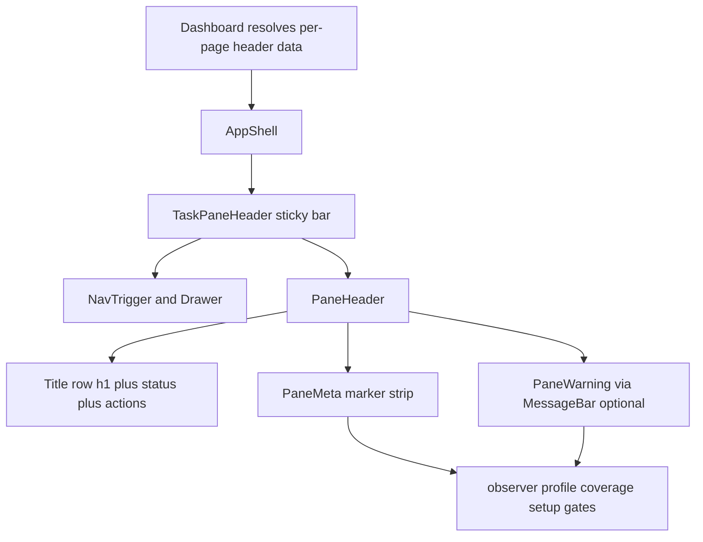

# Pane Header System — UX audit and implementation plan

**Date:** 2026-10-10
**Status:** Implemented — revision 3. The density and cleanup pass in
[`pane-header-review-and-cleanup-plan.md`](plans/pane-header-review-and-cleanup-plan.md)
is folded in, so the markup in §7 and the numbers in §5.5–§5.7 are the delivered
code rather than the original proposal.
**Scope:** Every destination in `src/taskpane/pages/` and `src/taskpane/components/`.
**Supersedes:** the "brand lockup" open question in
[`deterministic-profile-page-consistency-plan.md`](plans/deterministic-profile-page-consistency-plan.md:174)
(D-d / S8) — this plan answers it rather than restating it.
**Related ADRs:** new ADR-0138 (one page header, and the product name is not the
page title). See [§11](#11-documentation-and-decision-records).

---

## 1. Summary

The pane's sticky header currently spends its prime slot on the product name.
Every page renders `<h1 class="tf-title">ToneForge</h1>`, so the most valuable
band of a 329 × 445 px surface says the one thing the user already knows, on
every page, and the page's real title is either a smaller `<h2>` or absent.

This plan replaces the brand lockup with a **single, reusable `PaneHeader`** that
puts the **page title** in the prime slot and a **compact, per-page metadata
strip** directly beneath it. One component, one layout, one visual language, four
levels chosen by the pane's role — not ten bespoke headers.

The four levels, as corrected by the owner:

| Level                                   | Panes                                                     | Header role                                                        |
| --------------------------------------- | --------------------------------------------------------- | ------------------------------------------------------------------ |
| **Home** — the front landing page       | Home                                                      | identity + readiness at a glance                                   |
| **Review** — three peer review surfaces | Deterministic Review, Semantic Review, Consistency Review | title, status, document facts, severity, freshness, actions        |
| **Workspace** — the editable spaces     | Deterministic Style, Semantic Style, Governance           | title, the governing style/policy, validation, actions             |
| **Utility** — the support spaces        | General Settings, LLM Settings, Troubleshooting           | title, and a warning only when configuration is missing or invalid |

**Styling is owned by Fluent v9.** The header is composed from Fluent
components (`Text`, `Badge`, `MessageBar`) and Fluent `tokens` through
`makeStyles`, exactly as the existing shell does in
[`PaneHeader.tsx`](src/taskpane/shell/PaneHeader.tsx) and
[`Section.tsx`](src/taskpane/shell/Section.tsx:4). This plan introduces **no
bespoke marker CSS system** — it reuses the Fluent primitives and the existing
ToneForge wrappers so the look stays uniform while a small, fixed set of
**markers** distinguishes the key facts ([§5.4](#54-markers-uniform-frame-distinct-facts)).

Deliverables in this document:

- [§2](#2-audit-findings) the audit findings;
- [§3](#3-rationale-for-removing-the-generic-title) the rationale for removing
  the redundant title, including the accessibility defect it causes;
- [§4](#4-benchmark-patterns) the benchmark patterns the design is drawn from;
- [§5](#5-target-header-architecture) the reusable architecture, levels, and
  markers;
- [§6](#6-pane-inventory-and-per-pane-header-specifications) per-pane
  specifications with empty and error states;
- [§7](#7-markup-visualizations) lightweight HTML markup visualizations;
- [§8](#8-step-by-step-refactoring-plan) the step-by-step refactor;
- [§9](#9-verification-plan) and [§10](#10-risks-and-open-decisions).

---

## 2. Audit findings

### 2.1 What the header shows today

Two headers exist, and they overlap.

**App header — [`TaskPaneHeader.tsx`](src/taskpane/components/TaskPaneHeader.tsx:31)**, rendered sticky by
[`AppShell.tsx`](src/taskpane/shell/AppShell.tsx:37):

| Element                               | Source                                                                | Notes                             |
| ------------------------------------- | --------------------------------------------------------------------- | --------------------------------- |
| `<h1 class="tf-title">ToneForge</h1>` | [`TaskPaneHeader.tsx`](src/taskpane/components/TaskPaneHeader.tsx:86) | identical on every page           |
| `Active profile {name} r{rev}`        | [`TaskPaneHeader.tsx`](src/taskpane/components/TaskPaneHeader.tsx:87) | on every page, relevant on some   |
| `Last scan: {time}`                   | [`TaskPaneHeader.tsx`](src/taskpane/components/TaskPaneHeader.tsx:95) | on every page                     |
| Hamburger → navigation drawer         | [`TaskPaneHeader.tsx`](src/taskpane/components/TaskPaneHeader.tsx:76) | the only genuinely global element |

**Page header — currently ad-hoc per page**, and the shared primitive is
**unused**:

| Page                 | Heading today                                             | Where                                                                   |
| -------------------- | --------------------------------------------------------- | ----------------------------------------------------------------------- |
| Home                 | `<Text weight="semibold" size={500}>ToneForge</Text>`     | [`Home.tsx`](src/taskpane/pages/Home.tsx:99)                            |
| Deterministic Review | **none** (goes straight to a breadcrumb)                  | [`Dashboard.tsx`](src/taskpane/pages/Dashboard.tsx:1776)                |
| Semantic Review      | `<h1 class="tf-title">Semantic Review</h1>` + intro       | [`SemanticReview.tsx`](src/taskpane/pages/SemanticReview.tsx:489)       |
| Semantic Style       | `<h1 class="tf-title">Semantic Style</h1>` + intro        | [`SemanticStyle.tsx`](src/taskpane/pages/SemanticStyle.tsx:268)         |
| Consistency Review   | **none** (breadcrumb only)                                | [`ConsistencyReview.tsx`](src/taskpane/pages/ConsistencyReview.tsx:225) |
| Deterministic Style  | `<h1 class="tf-title">Deterministic Style Profile</h1>`   | [`Profile.tsx`](src/taskpane/pages/Profile.tsx:56)                      |
| Governance           | `<h1 class="tf-title">Governance Policy</h1>`             | [`GovernancePolicy.tsx`](src/taskpane/pages/GovernancePolicy.tsx:47)    |
| Troubleshooting      | `<h1 class="tf-title">Troubleshooting & diagnostics</h1>` | [`DebuggingPanel.tsx`](src/taskpane/components/DebuggingPanel.tsx:279)  |
| LLM Settings         | `<h2 class="tf-title">LLM Settings</h2>`                  | [`LlmSettings.tsx`](src/taskpane/pages/LlmSettings.tsx:24)              |
| General Settings     | `<h2 class="tf-title">General Settings</h2>`              | [`GeneralSettings.tsx`](src/taskpane/pages/GeneralSettings.tsx:30)      |

`PageHeader.tsx` (since deleted) was written to be the one
page header (it is documented "spec §26"), was exported from
[`shell/index.ts`](src/taskpane/shell/index.ts:4), and **was imported by no page**.
The unification was planned and never wired. It was **deleted** by this work
rather than evolved in place: [`PaneHeader.tsx`](src/taskpane/shell/PaneHeader.tsx)
is a new file, and the orphaned twin was removed once nothing imported it, so the
end state is one header with no divergent copy (A2 in the
[cleanup plan](plans/pane-header-review-and-cleanup-plan.md)).

### 2.2 The redundancy is also an accessibility defect

This is more than wasted pixels:

- **The `<h1>` never names the page.** Every page's top-level heading is
  `ToneForge`. A screen-reader user pressing `1` to jump to the page heading
  lands on the product name on all ten pages, and cannot tell them apart.
- **Heading level inverts with priority.** Where a page does have a title, it is
  an `<h2 class="tf-title">` (the two settings pages) or absent (Deterministic
  Review, Consistency Review) beneath the "ToneForge" `<h1>`. The document
  outline says the product name is the page and the page is a subsection.
- **The route label already exists and disagrees with the heading.** The active
  destination label lives once in [`ROUTES`](src/taskpane/routes.ts:74) and is
  what the drawer and the ribbon show. The heading is a second, drifting copy —
  and on three pages it is missing entirely.

### 2.3 Vertical-space budget

Microsoft documents the Word task pane as **329 × 445 px**. Measured against the
current CSS ([`taskpane.css`](src/taskpane/taskpane.css:804)) the app header is a
56 px minimum with three stacked lines of content (brand, active profile, last
scan) plus 8/12 px padding and a 16 px bottom margin — roughly **72–88 px, about
one fifth of the pane height**, repeated on every page, carrying information that
is duplicated elsewhere (the profile appears again on Home's cards; the scan time
appears again in the stale banner and diagnostics). The fix also frees the second
copy: each page's own `<h1>`/`<h2 class="tf-title">` and intro paragraph become
the header's content instead of a separate stacked block.

### 2.4 Mislabeling: the Deterministic Review pane is not a "dashboard"

The primary review surface is implemented as `Dashboard.tsx` and typed
`DashboardPage`. "Dashboard" is a legacy internal name. The **user-facing route
label is already "Deterministic Review"** ([`ROUTES`](src/taskpane/routes.ts:76)),
and the drawer and ribbon already say so. Two consequences for this plan:

1. The header title for that pane is **"Deterministic Review"**, exactly the route
   label — never "Dashboard".
2. It is a **peer of Semantic Review and Consistency Review**, all three at the
   Review level ([§5.2](#52-levels)). It is the surface the other two are entered
   from, but that does not make it a different level.

The internal `Dashboard` file and type names remain naming debt, out of scope for
a header change (minimal diff); they are noted for a separate cleanup.

### 2.5 The unrelated global heading work

[`deterministic-profile-page-consistency-plan.md`](plans/deterministic-profile-page-consistency-plan.md:141)
already moves `.tf-title` globally to a 21 px `<h1>` (its S7/S8) and explicitly
left the brand lockup as an **open question**: _"at 21px the product name sits in
the header of every page … if the visual review finds it dominating, the remedy
is one explicit opt-out class on the lockup."_ This plan is that visual review,
and it chooses removal over the opt-out class. The two plans must land in a
defined order — see [§8.0](#80-ordering-against-the-existing-heading-plan).

---

## 3. Rationale for removing the generic title

**The page title belongs in the header; the product name does not.**

1. **The heading slot is a navigation affordance, not a banner.** VS Code, Linear,
   Notion, Figma, and JetBrains all reserve the primary heading for _what you are
   looking at now_, and put product identity in chrome the content does not own
   (title bar, activity rail, breadcrumb root). The pane's content-owned heading
   should name the content.
2. **It is the accessible name of the page.** One `<h1>` per pane, equal to the
   route label, makes the page navigable and unambiguous. The current shared
   "ToneForge" `<h1>` defeats heading navigation.
3. **It removes a duplicate, not an identity.** The name already appears in the
   ribbon (`ToneForgeTaskpane`, ADR-0101), in the drawer header, and in the
   manifest. The header copy is the only redundant one.
4. **It buys the space the metadata needs.** Removing three stacked lines and
   absorbing each page's own title block nets the review panes _more_ room for the
   scan metadata the user actually opens the pane for, not less.

**One accuracy correction to the brief.** The brief assumes a native pane title
is "already provided by the host environment". A Microsoft Word task pane has
**no title bar or tab caption of its own** — the pane is an untitled web region.
So identity cannot be dropped from the pane entirely; it is **relocated**. The
product name stays as:

- the hamburger trigger's accessible name — "Open navigation" inside the
  ToneForge pane, with the drawer title retaining "ToneForge navigation";
- the drawer's own header (unchanged);
- the ribbon button and manifest (unchanged).

What goes away is only the _heading_ use of the name.

---

## 4. Benchmark patterns

| Tool               | Pattern                                                                                                                                     | What ToneForge adopts                                                                                                             |
| ------------------ | ------------------------------------------------------------------------------------------------------------------------------------------- | --------------------------------------------------------------------------------------------------------------------------------- |
| **VS Code**        | Editor tab/panel title is the document; context (branch, problems, sync) sits in a compact status row, truncated with a full-value tooltip. | Title = page; a one-line metadata strip of markers; truncate + `title` for the full value.                                        |
| **Linear**         | Header = title + a live status chip + a right-aligned action cluster; a single meta line carries the most important facts.                  | Status badge beside the title; actions pinned right; one dense meta line.                                                         |
| **Notion**         | Page title is the largest text and is the editable affordance; metadata is deliberately quiet beneath it.                                   | The page title takes the type ramp's Title level; metadata is muted, never competes.                                              |
| **Figma**          | One consistent toolbar frame across modes; the frame does not change shape, only its contents do.                                           | One `PaneHeader` component; the _frame_ is fixed, the contents are props.                                                         |
| **JetBrains IDEs** | Breadcrumb sits above the content title; a run-configuration/status widget sits beside it; density is user-tunable.                         | Existing [`Breadcrumb`](src/taskpane/shell/Breadcrumb.tsx:34) stays as the auxiliary row; density is a level, not a user setting. |

Shared principles distilled: **fixed frame, variable contents; title first;
metadata second and quiet; status as text plus icon (never colour alone, spec
§15); actions right; truncate with the full value in the tooltip; one landmark,
one `<h1>`, styling from Fluent v9.**

---

## 5. Target header architecture

### 5.1 Component topology



- [`TaskPaneHeader.tsx`](src/taskpane/components/TaskPaneHeader.tsx:31) keeps its
  real job — the sticky bar, the hamburger, and the navigation drawer — and
  **loses the brand lockup**. It gains a `paneHeader` slot rendered in the space
  the lockup occupied.
- [`PaneHeader.tsx`](src/taskpane/shell/PaneHeader.tsx) is the one page header.
  The plan said "evolve `PageHeader.tsx` in place"; the delivery added a new file
  and then deleted the orphaned `PageHeader.tsx` and its export, which reaches the
  same end state — one header, no divergent twin — without a rename that would
  have churned every import for no gain.
- [`Dashboard.tsx`](src/taskpane/pages/Dashboard.tsx:318) already holds every
  input a header needs (`status`, `activeProfile`, `caps`, `persisted`,
  `consistencyResult`, `semanticReviewStatus`) and already constructs
  `TaskPaneHeader`. It builds the `PaneHeader` props in the same place, so **no
  new state owner is introduced** (ADR-0126, ADR-0132).

### 5.2 Levels

One component, `level` selected by the pane's role. The layout does not change —
only which slots are populated.

| Level       | Panes                                                     | Slots populated                                                               | Marker density         |
| ----------- | --------------------------------------------------------- | ----------------------------------------------------------------------------- | ---------------------- |
| `landing`   | Home                                                      | title, overall status, two identity facts                                     | low (2–3 markers)      |
| `review`    | Deterministic Review, Semantic Review, Consistency Review | title, status, full document facts, freshness, actions                        | high (up to 6 markers) |
| `workspace` | Deterministic Style, Semantic Style, Governance           | title, the governing style/policy + revision, validation, actions             | medium (2–3 markers)   |
| `utility`   | General Settings, LLM Settings, Troubleshooting           | title; a warning strip only when required configuration is missing or invalid | minimal (0–1 marker)   |

The three Review panes share the `review` level even though their facts differ:
Deterministic Review shows scan scope and severity counts; Semantic Review shows
the selection and consent/provider; Consistency Review shows the provider, model,
and last run. Same frame, different markers ([§6](#6-pane-inventory-and-per-pane-header-specifications)).

### 5.3 Contract

```ts
// src/taskpane/shell/PaneHeader.tsx
export type PaneHeaderLevel = "landing" | "review" | "workspace" | "utility";

export interface PaneMarker {
  /** Machine-readable key for tests and for React keys. */
  key: string;
  /** The reader's label, e.g. "Last scan". Omitted only where the value is self-describing. */
  label?: string | undefined;
  value: string;
  /** A semantic tone when the value is itself a status (never colour-only, spec §15). */
  tone?: MarkerTone | undefined;
  icon?: ToneForgeIconName | undefined;
  /** Full value, shown on hover when `value` is truncated. */
  title?: string | undefined;
}

export interface PaneWarning {
  tone: "warning" | "danger";
  title: string;
  body: string;
  action?: React.ReactNode | undefined;
}

export interface PaneHeaderProps {
  /** The pane's one <h1>. Defaults to `routeLabel(destination)`. */
  title: string;
  /** One short purpose line. Long intros move into the body (see §6). */
  description?: string | undefined;
  /**
   * Status vocabulary label (spec §14). Rendered as a badge.
   *
   * The tone is deliberately not accepted here: `StatusBadge` derives it from
   * the label, so a caller passing a tone that disagreed with the vocabulary
   * would be silently overridden. One owner per mapping.
   */
  status?: { label: ToneForgeStatus } | undefined;
  /** The dense marker strip. Rendered as a <dl> of Fluent Text plus markers. */
  markers?: readonly PaneMarker[] | undefined;
  /** Contextual actions, right-aligned on the title row. */
  actions?: React.ReactNode | undefined;
  /** Utility/workspace only: a single prominent warning, via Fluent MessageBar. */
  warning?: PaneWarning | null | undefined;
  /** The visual level, which controls icon and spacing. */
  level?: PaneHeaderLevel | undefined;
  /** Optional class name for the root element. */
  className?: string | undefined;
}
```

Two departures from the proposal, both recorded in the
[cleanup plan](plans/pane-header-review-and-cleanup-plan.md):

- **`status` carries no tone.** The proposal accepted `tone?: StatusTone` and
  `detail?: string`; neither was ever read. `StatusBadge` derives the tone from
  the vocabulary label, so accepting one invited a caller to pass a tone that
  would be silently overridden (B7).
- **`level` is optional and defaults to `utility`.** The proposal made it
  required. Every pane passes it explicitly, so the default only exists to keep
  the component usable in isolation; the four levels are unchanged.

Two rules the contract encodes:

1. **`title` defaults to `routeLabel(destination)`.** The header cannot drift
   from the drawer, the ribbon, or [`ROUTES`](src/taskpane/routes.ts:74), because
   it reads the same source. "Deterministic Review" is therefore structural, not
   a string someone must remember to change.
2. **Every marker is plain text.** No marker is a live region. Consistent with
   ADR-0062 and [`accessibility.md`](docs/accessibility.md:98), the pane keeps
   exactly one live region, in [`AppShell`](src/taskpane/shell/AppShell.tsx:42);
   the header updates silently.

### 5.4 Markers: uniform frame, distinct facts

Styling is Fluent v9's. The header adds **no custom colour tokens and no bespoke
class system**. Each key fact is rendered by an existing Fluent primitive or a
thin ToneForge wrapper, so the frame is uniform and only the _marker type_
changes:

| Marker           | Fact it carries                             | Primitive                                                                                                   |
| ---------------- | ------------------------------------------- | ----------------------------------------------------------------------------------------------------------- |
| Status marker    | scan / review status (spec §14)             | [`StatusBadge`](src/taskpane/components/common/StatusBadge.tsx:74) — Fluent `Badge`, tone drives `color`    |
| Freshness marker | Fresh / Stale / Unavailable                 | Fluent `Badge` via [`ToneBadge`](src/taskpane/components/common/StatusBadge.tsx:103), icon + text           |
| Severity marker  | mandatory / advisory / informational counts | Fluent `Badge`, `color` from tone; the count is text                                                        |
| Revision marker  | `{style} · r{n}`                            | Fluent `Text` + a small `Badge` for `r{n}`                                                                  |
| Scope marker     | examined scopes                             | Fluent `Text` with `title`; the full list is in `title`                                                     |
| Provider marker  | provider + model                            | Fluent `Text`                                                                                               |
| Warning marker   | missing/invalid configuration               | Fluent `MessageBar` with `intent`, matching [`StaleBanner.tsx`](src/taskpane/components/StaleBanner.tsx:41) |

Layout uses `makeStyles` + `mergeClasses` + Fluent `tokens` for spacing and
typography, identical to [`PaneHeader.tsx`](src/taskpane/shell/PaneHeader.tsx)
and [`Section.tsx`](src/taskpane/shell/Section.tsx:4). The legacy `.tf-brand-lockup`
and `.tf-active-profile` selectors in [`taskpane.css`](src/taskpane/taskpane.css:821)
are **deleted**, not renamed.

### 5.5 Hierarchy and density

```
row 1   [☰]  ⛭  Deterministic Review          [ Needs review ]
             ───────────────────────────────────────────────────
row 2        Last scan 16:04 · Scope body, headings · Open 4 findings ·
             Coverage Partial · Style Finance · r3
```

- Title: Fluent `Text` at `size={400}` (16px), one line,
  `text-overflow: ellipsis`, `min-width: 0`. This is a deliberate step below the
  ramp's 21px Title size: the header is chrome, not the page's content, and the
  ramp's Title step is reserved for the page's own headings (B2).
- Icon: 16px, `colorNeutralForeground2`. It is a level cue, not an accent — the
  status badge is the single saturated element in the row (B6).
- Status: [`StatusBadge`](src/taskpane/components/common/StatusBadge.tsx:74); text
  is always present, icon and colour supplement it (spec §15).
- Markers: a Fluent `Text`-based `<dl>`; `label` muted, `value` emphasised; wraps
  at the pane width; each marker is `nowrap` with ellipsis. The strip is capped at
  **two lines** (`maxHeight` + `overflow: hidden`), so a pane carrying many
  markers cannot grow the header without limit (B5).
- Actions: a Fluent `Button` cluster, `flex-wrap`. In the delivered code the
  review panes' contextual actions (Re-scan, Preview changes) live in the page
  body's toolbar, not in the header — see §6.1.

### 5.6 Truncation behaviour

| Element      | Rule                                                                     |
| ------------ | ------------------------------------------------------------------------ |
| Title        | ellipsis; full value in the element's `title`; never wraps to two lines. |
| Description  | one line, ellipsis; full value in `title`.                               |
| Marker value | ellipsis per marker; full value in the marker's `title`.                 |
| Marker label | `max-width: 40%`; ellipsis; visually hidden below 300px (§5.7).          |
| Scope list   | every examined scope, joined; the full list is also in `title`.          |
| Status badge | never truncated; the vocabulary is fixed and short.                      |

The scope list is **not** truncated to three with a `+N more` suffix. The
observer already narrows the examined scope to what it read (ADR-0063), so the
list is short by construction; a `+N more` affordance would have been a second
truncation rule for a value that does not need one.

### 5.7 Responsiveness

| Width                            | Behaviour                                                                                                                        |
| -------------------------------- | -------------------------------------------------------------------------------------------------------------------------------- |
| ≥ 300 px (the task-pane default) | title row and marker strip as drawn.                                                                                             |
| < 300 px (narrow docked pane)    | marker labels hide (label visually hidden, value keeps `title`); the strip stays a wrapping flex row, capped at two lines.       |
| High contrast                    | Fluent components inherit the theme's high-contrast tokens; the warning `MessageBar` keeps its built-in high-contrast treatment. |
| `prefers-reduced-motion`         | no transition on the sticky bar or the drawer (unchanged from today).                                                            |

The breakpoint was raised from 260px to **300px** and the strip does **not**
become a scrolling single line. A hidden scrollbar is a second interaction model
for the same content, and at 260px the values alone still fit one line once the
labels are gone — so the labels are the only thing that needs to go (B5).

### 5.8 Accessibility invariants

These are the acceptance criteria for the refactor; each is asserted by a test
(§9).

1. **Exactly one `<h1>` per pane**, equal to the page title.
2. The `<h1>` is the first heading in the accessibility tree; the drawer's `<h2>`
   remains unchanged (it is a dialog, not the page).
3. The nav trigger's accessible name is "Open navigation" and does **not** repeat
   the page title (ADR-0135 guards accessible names).
4. Status is text + icon, never colour alone (spec §15).
5. No marker, action, or warning creates a second live region; the pane's one
   region stays in [`AppShell`](src/taskpane/shell/AppShell.tsx:42) (ADR-0062).
6. Focus order: drawer trigger → title → actions → markers → (warning action) →
   page body. Verified by keyboard traversal at 329 px in both themes.

---

## 6. Pane inventory and per-pane header specifications

Data sources already exist for every column below; the header adds no new
derivation. Sources are named per cell and listed in [§12](#12-appendix-data-sources).

### 6.1 Summary table

| Page (route)                          | Level       | Title (`<h1>`)       | Primary markers                                                        | Status                                                              | Validation / warning                                      | Contextual actions | Empty state                                                   | Error state                                               |
| ------------------------------------- | ----------- | -------------------- | ---------------------------------------------------------------------- | ------------------------------------------------------------------- | --------------------------------------------------------- | ------------------ | ------------------------------------------------------------- | --------------------------------------------------------- |
| Home (`landing`)                      | `landing`   | Home                 | deterministic style + revision; semantic style + revision or None yet  | `Ready` / `Not checked`                                             | none (setup card owns it)                                 | none               | "No styles yet" in markers                                    | status `Error` + `failed` phase                           |
| Deterministic Review (`review`)       | `review`    | Deterministic Review | style + revision; last scan; scope; open counts by severity; freshness | `Not checked`/`In progress`/`Complete`/`Incomplete`/`Stale`/`Error` | freshness marker, not a strip                             | in the page body   | scope "nothing", counts "No open findings", last scan "never" | `Error` badge + error line; host loss reads `Unavailable` |
| Semantic Review (`semantic-review`)   | `review`    | Semantic Review      | active semantic style + revision; selection size; provider; freshness  | `Not checked`/`In progress`/`Needs review`/`Stale`                  | warning strip when consent or provider missing            | in the page body   | selection "Nothing selected"                                  | `Error` + error line                                      |
| Consistency Review (`consistency`)    | `review`    | Consistency Review   | provider; model; last run coverage; consent; freshness                 | `Not checked`/`In progress`/`Complete`/`Incomplete`/`Error`         | warning strip when consent/provider missing               | in the page body   | "Not run yet"                                                 | `Error` + refused reason                                  |
| Deterministic Style (`profile`)       | `workspace` | Deterministic Style  | name + revision; validation counts; last saved                         | `Complete`/`Incomplete`/`Error`                                     | warning strip when validation fails                       | in the page body   | new draft "Untitled draft"                                    | `Error` + validation summary                              |
| Semantic Style (`semantic-style`)     | `workspace` | Semantic Style       | active semantic style + revision; activation (Active / Draft)          | `Approved`/`Not checked`                                            | warning strip when no profile exists                      | in the page body   | "No semantic profile"                                         | `Error` + error line                                      |
| Governance (`governance-policy`)      | `workspace` | Governance Policy    | active governance profile; protected ranges; policy revision           | `Complete`/`Incomplete`                                             | warning when protected ranges present and uncovered       | in the page body   | default policy "House default"                                | `Error` + reason                                          |
| General Settings (`general-settings`) | `utility`   | General Settings     | none                                                                   | `Ready`/`Incomplete`                                                | warning strip when tracked editing is off (Apply blocked) | in the page body   | n/a                                                           | `Error` + reason                                          |
| LLM Settings (`llm-settings`)         | `utility`   | LLM Settings         | none                                                                   | `Ready`/`Unavailable`                                               | warning strip when provider required but missing/invalid  | in the page body   | "No provider connected"                                       | `Error` + gateway reason                                  |
| Troubleshooting (`troubleshooting`)   | `utility`   | Troubleshooting      | none                                                                   | `Complete`/`Incomplete`                                             | warning strip when blockers present                       | in the page body   | "Nothing stood in the way"                                    | `Error` + reason                                          |

**Contextual actions live in the page body, not the header.** The proposal put a
right-aligned action cluster on the title row. The delivered header keeps the
`actions` slot in its contract, but no pane uses it: every action a page needs
(Re-scan, Preview changes, Save, Run check, Diagnose host) already has a home in
the page's own toolbar, where it sits beside the content it acts on and can carry
a disabled state with its reason. Duplicating them in the header would have put
two controls with the same name in one pane and cost the title row the width the
markers need (A5).

### 6.2 Review level — the flagship spec (Deterministic Review)

The brief's required content, mapped to a marker and a source:

| Fact                            | Marker                          | Source                                                                                                    | Empty / absent                                     |
| ------------------------------- | ------------------------------- | --------------------------------------------------------------------------------------------------------- | -------------------------------------------------- |
| Active deterministic style name | `Style`                         | `activeProfile.name`                                                                                      | "No active style"                                  |
| Revision number                 | `Style` (same marker, `· r{n}`) | `activeProfile.revision`                                                                                  | omitted                                            |
| Last document scan timestamp    | `Last scan`                     | `observerStatus.lastScan`                                                                                 | omitted (no scan yet)                              |
| Document scope                  | `Scope`                         | `deterministicCoverage.examinedScopes` via [`scopeLabel`](src/taskpane/components/CoverageBanner.tsx:101) | omitted (nothing examined)                         |
| Issue counts by severity        | `Open`                          | [`summarizeOpenFindings`](src/taskpane/findingsSummary.ts:87) → mandatory / advisory / informational      | "No open findings"                                 |
| Scan status                     | status marker                   | [`DocumentScanPhase`](src/word/documentObserver.ts:28) mapped to the vocabulary                           | `Not checked`                                      |
| Staleness                       | freshness marker                | `status.stale`, `status.hostUnavailable`                                                                  | `Fresh`, or `Stale`, or `Unavailable` on host loss |

Notes:

- **Counts use the same list the page shows.** `summarizeOpenFindings` is already
  called with the ignore predicate in
  [`Dashboard.tsx`](src/taskpane/pages/Dashboard.tsx:1668); the header reads that
  result, so the header and the Findings section cannot disagree — the exact
  defect the summary module documents.
- **The verdict is not repeated.** "Compliant within checked scope" is a
  compliance claim ([`coverageVerdict.ts`](src/taskpane/coverageVerdict.ts:62))
  and stays on the coverage banner, where the reasoning lives. The header shows
  status and counts, not a verdict.
- **Staleness is a marker, not a `MessageBar`.** The banner
  ([`StaleBanner.tsx`](src/taskpane/components/StaleBanner.tsx:26)) remains the
  place the user is _prompted_; the header only _indicates_. The Re-scan action
  is the same handler.

Semantic Review and Consistency Review use the same `review` level and frame, with
the markers in the table above: Semantic Review leads with the active semantic
style and the selection size; Consistency Review leads with the provider and the
last run's coverage. Freshness applies to both — Semantic Review's session has a
`stale` state, and Consistency Review's result is discarded when the document
moves.

### 6.3 Workspace level

The three editable spaces lead with the thing being edited and its validity:

| Pane                | Leading markers                                        | Status                          | Warning                       |
| ------------------- | ------------------------------------------------------ | ------------------------------- | ----------------------------- |
| Deterministic Style | profile name · `r{n}`; validation error/warning counts | `Complete`/`Incomplete`/`Error` | validation summary on failure |
| Semantic Style      | active style name · `r{n}`; Active / Draft             | `Approved`/`Not checked`        | no profile exists             |
| Governance          | governance profile; protected ranges count             | `Complete`/`Incomplete`         | protected ranges uncovered    |

### 6.4 Utility level

Per the brief, these stay minimal: **title + a warning only when required
configuration is missing or invalid.** No marker strip by default.

| Pane             | Warning condition                           | Warning text (from an existing source)                                                                 |
| ---------------- | ------------------------------------------- | ------------------------------------------------------------------------------------------------------ |
| General Settings | `!trackedEditingEnabled`                    | [`applyReadiness`](src/taskpane/settings/applyReadiness.ts:73) reason — "Tracked editing is disabled…" |
| General Settings | no active deterministic profile             | [`setupStatus`](src/taskpane/setupStatus.ts:83) `blocksScanning`                                       |
| LLM Settings     | remote provider required but not configured | [`setupStatus`](src/taskpane/setupStatus.ts:111) `llmProvider.blocked`                                 |
| Troubleshooting  | `SetupStatus.complete === false`            | count of open setup items, with a link to Home                                                         |

The warning text is **always the existing string from its owning module**, never a
second formulation — the rule that keeps a disabled control and its reason from
disagreeing ([`applyReadiness`](src/taskpane/settings/applyReadiness.ts:6),
ADR-0069). The strip renders through Fluent `MessageBar`, exactly as
[`StaleBanner.tsx`](src/taskpane/components/StaleBanner.tsx:41) already does.

---

## 7. Markup visualizations

Lightweight, semantic markup for each distinct level. These show hierarchy and
placement; the real components are Fluent v9 (`Text`, `Badge`, `MessageBar`) with
`makeStyles`, so the class names below are schematic hooks, not a new stylesheet.

The nav trigger is **not** part of `PaneHeader`. It belongs to the sticky bar
([`TaskPaneHeader.tsx`](src/taskpane/components/TaskPaneHeader.tsx:68)), which
renders the trigger in one grid column and the pane header in the next. The
visualizations below therefore start at the pane header itself.

### 7.1 `landing` (Home)

```html
<header class="tf-pane-header tf-pane-header--landing">
  <div class="tf-pane-header__row">
    <div class="tf-pane-header__heading">
      <svg class="tf-pane-header__icon" aria-hidden="true" />
      <h1 class="tf-pane-header__title" title="Home">Home</h1>
    </div>
    <span class="tf-status-badge tf-status-badge--warning">
      <svg aria-hidden="true">!</svg> Incomplete
    </span>
  </div>
  <p class="tf-pane-header__desc">Your document, styles, and reviews at a glance.</p>
  <dl class="tf-pane-header__markers">
    <div class="tf-marker">
      <dt>Deterministic style</dt>
      <dd title="No deterministic style profile exists yet.">None yet</dd>
    </div>
    <div class="tf-marker">
      <dt>Semantic style</dt>
      <dd title="No semantic style profile exists yet.">None yet</dd>
    </div>
  </dl>
</header>
```

### 7.2 `review` (Deterministic Review shown; same frame for Semantic and Consistency)

```html
<header class="tf-pane-header tf-pane-header--review">
  <div class="tf-pane-header__row">
    <div class="tf-pane-header__heading">
      <svg class="tf-pane-header__icon" aria-hidden="true" />
      <h1 class="tf-pane-header__title" title="Deterministic Review">Deterministic Review</h1>
    </div>
    <span class="tf-status-badge tf-status-badge--warning">
      <svg aria-hidden="true">!</svg> Needs review
    </span>
  </div>
  <dl class="tf-pane-header__markers">
    <div class="tf-marker">
      <dt>Last scan</dt>
      <dd title="Last scan at 16:04.">16:04</dd>
    </div>
    <div class="tf-marker">
      <dt>Scope</dt>
      <dd title="The last scan examined: Body, Headings.">Body, Headings</dd>
    </div>
    <div class="tf-marker">
      <dt>Open</dt>
      <dd title="2 errors, 1 warning">4 findings</dd>
    </div>
    <div class="tf-marker">
      <dt>Coverage</dt>
      <dd title="The scan did not cover the whole document.">Partial</dd>
    </div>
    <div class="tf-marker">
      <dt>Style</dt>
      <dd title="Revision 3">Finance · r3</dd>
    </div>
  </dl>
</header>
```

There is **no description** on the `review` level, and **no action cluster** on
the title row. The review panes are the densest in the product, and both slots
were spent on content the page body already carries: the intro paragraph is the
first section's description, and Re-scan / Preview changes live in the findings
toolbar beside the list they act on (A4, A5).

### 7.3 `workspace` (Deterministic Style shown)

```html
<header class="tf-pane-header tf-pane-header--workspace">
  <div class="tf-pane-header__row">
    <div class="tf-pane-header__heading">
      <svg class="tf-pane-header__icon" aria-hidden="true" />
      <h1 class="tf-pane-header__title" title="Deterministic Style">Deterministic Style</h1>
    </div>
  </div>
  <p class="tf-pane-header__desc">
    The typography and house-style rules ToneForge checks deterministically.
  </p>
  <dl class="tf-pane-header__markers">
    <div class="tf-marker">
      <dt>Profile</dt>
      <dd title="Revision 3">Finance · r3</dd>
    </div>
  </dl>
</header>
```

### 7.4 `utility` (General Settings shown, warning active)

```html
<header class="tf-pane-header tf-pane-header--utility">
  <div class="tf-pane-header__row">
    <div class="tf-pane-header__heading">
      <svg class="tf-pane-header__icon" aria-hidden="true" />
      <h1 class="tf-pane-header__title" title="General Settings">General Settings</h1>
    </div>
    <span class="tf-status-badge tf-status-badge--warning">
      <svg aria-hidden="true">!</svg> Incomplete
    </span>
  </div>
  <p class="tf-pane-header__desc">Control scanning, tracked editing, and how the add-in looks.</p>
  <div class="tf-message-bar tf-message-bar--warning" role="note">
    <strong>Tracked editing is off</strong>
    Turn on tracked editing so changes can be applied.
  </div>
</header>
```

When the warning is absent, the `utility` header is exactly the title row, the
description, and no marker strip — no empty slots. `role="note"` on the warning is
deliberate: it is a static note, not a live region (invariant 5, §5.8). The
`MessageBar` renders with `layout="multiline"`, so its padding is even on every
side and the body wraps instead of running under the action (C1).

---

## 8. Step-by-step refactoring plan

Each phase leaves the pane shippable and the suite green. File paths are exact.

### 8.0 Ordering against the existing heading plan

The heading ramp plan ([S7/S8](plans/deterministic-profile-page-consistency-plan.md:236))
and this plan both touch `.tf-title` and the header. Two safe orders:

- **Preferred:** this plan **after** the ramp plan, so the 21 px `<h1>` and the
  4 px grid already exist and `PaneHeader` only consumes them.
- **Acceptable:** this plan **first**, adopting the ramp values directly here;
  the ramp plan's S8 then becomes a no-op for the header (its brand-lockup item
  is gone) and S7 applies to the remaining headings.

Whichever is chosen, **S8's brand-lockup item is deleted** and this plan's ADR
records why. Do not run both header edits concurrently.

### Phase 0 — Baseline and guards

- [ ] Add `tests/unit/taskpane/shell/paneHeader.test.tsx` asserting the _current_
      defects are not re-introduced later: one `<h1>` per page, equal to the
      route label.
- [ ] Record ADR-0138 (see [§11](#11-documentation-and-decision-records)).
- [ ] Capture before/after screenshots at 329 px and 445 px, both themes, into
      `docs/manual-verification.md`.

### Phase 1 — Build the primitive

- [x] `src/taskpane/shell/PaneHeader.tsx`: implement `PaneHeaderProps`, the four
      levels, the title row, the marker `<dl>`, and the Fluent `MessageBar`
      warning. Keep the markers and warning as internal sub-components in the
      same file (YAGNI: no separate files). Delivered as a new file; the orphaned
      `PageHeader.tsx` was deleted afterwards (A2).
- [ ] Update [`shell/index.ts`](src/taskpane/shell/index.ts:4) to export
      `PaneHeader` (and keep a deprecated alias only if a test imports the old
      name).
- [ ] `src/taskpane/shell/headerMarkers.ts`: a **pure** module that maps the raw
      dashboard inputs to `PaneMarker[]` per page — no React, no Office, so it is
      unit-testable without a host (mirrors
      [`homeState.ts`](src/taskpane/pages/homeState.ts:1)).
- [ ] Tests: `tests/unit/taskpane/shell/paneHeader.test.tsx` (levels, truncation
      `title` attributes, warning is `role="note"`), and
      `tests/unit/taskpane/shell/headerMarkers.test.ts` (empty/error inputs).

### Phase 2 — Styling (Fluent v9)

- [x] Style `PaneHeader` with `makeStyles` + Fluent `tokens`, mirroring
      [`Section.tsx`](src/taskpane/shell/Section.tsx:4). No new colour literals
      (lint), no new `--tf-*` aliases, no bespoke marker classes.
- [ ] Delete `.tf-brand-lockup` and `.tf-active-profile` from
      [`taskpane.css`](src/taskpane/taskpane.css:821); keep `.tf-app-header`
      (sticky geometry, guarded by ADR-0135).
- [ ] Add the narrow-pane media query from [§5.7](#57-responsiveness) as a
      `makeStyles` media rule, not a stylesheet rule.

### Phase 3 — Re-home the sticky bar

- [ ] [`TaskPaneHeader.tsx`](src/taskpane/components/TaskPaneHeader.tsx:31): drop
      the `ToneForge` `<h1>`, the active-profile lockup, and the `lastScan` line.
      Keep the hamburger and the drawer verbatim. Add a `paneHeader` slot prop
      rendered where the lockup was.
- [ ] Change `TaskPaneHeaderProps`: remove `profileName`, `profileRevision`,
      `lastScan`; add `paneHeader: React.ReactNode`.
- [ ] Update the three call sites in
      [`Dashboard.tsx`](src/taskpane/pages/Dashboard.tsx:318) (no-profile branch,
      landing branch, general branch).

### Phase 4 — Data wiring, by level

Wire one pane per step, keeping the suite green after each.

- [ ] **Deterministic Review** (`review`): build the `review` level from
      `status`, `activeProfile`, `openSummary`, `readiness`. This is the flagship
      and the acceptance target for §6.2. Title is "Deterministic Review".
- [ ] **Semantic Review** and **Consistency Review** (`review`): the same frame,
      with their markers from
      [`gates.ts`](src/taskpane/semantic/gates.ts), `consistencyResult`, and the
      semantic record state.
- [ ] **Home** (`landing`): `homeState.activeDeterministicProfile` /
      `activeSemanticProfile`, `setup`.
- [ ] **Deterministic Style**, **Semantic Style**, **Governance** (`workspace`):
      the edited profile/policy + revision, validation, and protected ranges.
- [ ] **General Settings**, **LLM Settings**, **Troubleshooting** (`utility`):
      title only, plus the warning condition from §6.4.

### Phase 5 — Remove the duplicated page titles

- [ ] Delete the per-page `<h1>/<h2 class="tf-title">` from
      [`Profile.tsx`](src/taskpane/pages/Profile.tsx:56),
      [`GovernancePolicy.tsx`](src/taskpane/pages/GovernancePolicy.tsx:47),
      [`DebuggingPanel.tsx`](src/taskpane/components/DebuggingPanel.tsx:279),
      [`GeneralSettings.tsx`](src/taskpane/pages/GeneralSettings.tsx:30),
      [`LlmSettings.tsx`](src/taskpane/pages/LlmSettings.tsx:24),
      [`SemanticReview.tsx`](src/taskpane/pages/SemanticReview.tsx:489),
      [`SemanticStyle.tsx`](src/taskpane/pages/SemanticStyle.tsx:268), and the
      Home `<Text>ToneForge</Text>` at
      [`Home.tsx`](src/taskpane/pages/Home.tsx:99).
- [ ] Move each deleted title's intro `tf-sub` paragraph: short intros become the
      header `description`; long intros (Semantic Review, Semantic Style) become
      the first [`Section`](src/taskpane/shell/Section.tsx:54) description so the
      header stays dense.
- [ ] Keep each page's [`Breadcrumb`](src/taskpane/shell/Breadcrumb.tsx:34) as the
      auxiliary row beneath the sticky bar (unchanged behaviour, ADR-0137).

### Phase 6 — Density, truncation, and a11y pass

- [ ] Apply §5.5–§5.8 across all levels.
- [ ] Add `title` attributes for every truncated value (a test enumerates them).
- [ ] Keyboard traversal: drawer trigger → title → actions → markers → warning.

### Phase 7 — Verification

See [§9](#9-verification-plan).

---

## 9. Verification plan

### 9.1 Automated

| Check      | Command                 | Asserts                                             |
| ---------- | ----------------------- | --------------------------------------------------- |
| Types      | `npm run typecheck`     | `exactOptionalPropertyTypes` clean on the new props |
| Lint       | `npm run lint`          | no `any`, type-only imports, no colour literals     |
| Format     | `npm run format`        | Prettier clean                                      |
| Unit       | `npm run test`          | see the new test files below                        |
| Coverage   | `npm run test:coverage` | 80% floor on `src/taskpane/shell`                   |
| Full graph | `npm run verify`        | the ordered chain in the scaffold skill             |

New/updated tests (mirroring `src/`):

- `tests/unit/taskpane/shell/paneHeader.test.tsx` — one `<h1>` per level; status
  is text + icon; the warning is `role="note"` and never a live region;
  truncated values carry `title`.
- `tests/unit/taskpane/shell/headerMarkers.test.ts` — every empty/error input in
  §6 produces the specified string; the review counts equal
  `summarizeOpenFindings` on the same list.
- `tests/unit/taskpane/shell/singleH1.test.tsx` — renders every
  [`TaskPaneDestination`](src/taskpane/routes.ts:16) and asserts exactly one `<h1>`
  whose text equals `routeLabel(destination)` (the regression guard for §2.2 and
  the "Deterministic Review" title in §2.4).
- `tests/unit/taskpane/accessibleNames.test.ts` — extend the existing guard so the
  nav trigger's name does not equal the page title.
- `tests/integration/taskpane/headerWiring.test.tsx` — the Dashboard builds the
  right level and markers per page from the same state the body reads.

### 9.2 Manual (the human gate)

Recorded in [`docs/manual-verification.md`](docs/manual-verification.md), because
a mocked host is not host evidence (ADR-0051):

- [ ] Both themes, at 329 px and at a narrow docked width.
- [ ] Every pane shows one page title; no `ToneForge` heading anywhere; the
      primary review pane reads "Deterministic Review".
- [ ] The three Review panes share one frame; the three Utility panes stay
      minimal.
- [ ] The review header's counts match the Findings section after a scan and after
      ignoring a finding.
- [ ] Stale and host-unavailable both render, and Re-scan resolves staleness.
- [ ] Keyboard-only traversal; screen-reader reading of the header (headings
      list shows the page title).
- [ ] High-contrast mode: markers and the warning `MessageBar` remain legible.

A green `npm run verify` is **not** a release claim; the Word-host gate stays
open until the manual pass is signed.

---

## 10. Risks and open decisions

| #      | Risk / decision                                                                                                          | Mitigation / default                                                                                                                                   |
| ------ | ------------------------------------------------------------------------------------------------------------------------ | ------------------------------------------------------------------------------------------------------------------------------------------------------ |
| R1     | Removing all branding leaves the pane with no identity.                                                                  | Identity is relocated to the nav trigger name, the drawer header, and the ribbon (ADR-0101); validated in the manual pass.                             |
| R2     | The marker strip reflows and pushes the body down on long documents.                                                     | Capped density (labels hide < 300 px), truncation rules in §5.6, and the strip is bounded at two lines by `maxHeight`.                                 |
| R3     | A `<dl>` with hidden labels loses meaning.                                                                               | Labels hide only below 300 px; the value keeps a `title`, and status is never label-dependent.                                                         |
| R4     | Two plans touching `.tf-title`.                                                                                          | Sequencing rule in [§8.0](#80-ordering-against-the-existing-heading-plan); S8's brand item deleted.                                                    |
| R5     | Scope of "every pane" grows (future pages).                                                                              | The level is chosen by the pane's role, not by the page; a new page picks a level and passes `title` defaulting to its route label — no new component. |
| R6     | Semantic Review and Consistency Review were first scoped as workspaces.                                                  | Corrected: they are peers of Deterministic Review at the `review` level (§2.4, §5.2).                                                                  |
| **D1** | **Where product identity lives after removal.** (a) trigger name + drawer only; (b) also a small wordmark in the drawer. | **Default (a)**; (b) is a one-line drawer change if review wants it.                                                                                   |
| **D2** | **Whether the description line appears on `review`/`workspace`.**                                                        | Default: header description only on `landing`/`utility`; longer intros move into the body first section (§6.2 notes).                                  |
| **D3** | **Whether utility panes show any markers.**                                                                              | Default: none — title plus warning only, per the brief.                                                                                                |

Decisions D1–D3 are recorded as defaults in ADR-0138 and can be reversed without
re-architecture.

---

## 11. Documentation and decision records

- **New ADR-0138** in [`docs/decision-log.md`](docs/decision-log.md): _The page
  title is the heading; the product name is not._ Context: the redundant `<h1>`
  and the a11y defect (§2.2); the four pane levels and Fluent-owned styling (§5).
  Decision: one `PaneHeader`, four levels, title defaults to the route label;
  identity relocated to the drawer. Consequences: one `<h1>` per pane; the brand
  lockup and its CSS are removed; D1–D3 as recorded.
- **Amend** the heading plan's S8/D-d entry to point at ADR-0138 and delete the
  brand-lockup open question.
- **Update** [`docs/project-state.md`](docs/project-state.md) once implemented.
- **Update** [`docs/ux-state-matrix.md`](docs/ux-state-matrix.md:16) — the
  "fixed header contains … active-profile summary" sentence now describes
  pane-specific headers.
- **ROADMAP status note** per the commit-docs rule; the Word-host header check
  stays a manual gate.

Commit message (conventional, roadmap-aligned):

```
feat(ux): one pane header puts the page title in the prime slot
```

Body must state the _why_ (a11y + density) and cite ADR-0138.

---

## 12. Appendix: data sources

| Fact                                           | Source                                                                                                                             |
| ---------------------------------------------- | ---------------------------------------------------------------------------------------------------------------------------------- |
| Page title / label                             | [`routeLabel`](src/taskpane/routes.ts:170), [`ROUTES`](src/taskpane/routes.ts:74)                                                  |
| Scan phase, last scan, stale, host-unavailable | [`DocumentObserverStatus`](src/word/documentObserver.ts:43)                                                                        |
| Severity counts                                | [`summarizeOpenFindings`](src/taskpane/findingsSummary.ts:87)                                                                      |
| Scope labels                                   | [`scopeLabel`](src/taskpane/components/CoverageBanner.tsx:101)                                                                     |
| Coverage verdict (not shown in header)         | [`coverageVerdict`](src/taskpane/coverageVerdict.ts:55)                                                                            |
| Active profiles                                | [`selectActiveProfile`](src/core/state/profileSelectors.ts) in [`Dashboard.tsx`](src/taskpane/pages/Dashboard.tsx:1608)            |
| Setup completeness and blocker text            | [`setupStatus`](src/taskpane/setupStatus.ts:83)                                                                                    |
| Apply blocker text                             | [`applyReadiness`](src/taskpane/settings/applyReadiness.ts:72)                                                                     |
| Semantic gates                                 | [`semantic/gates.ts`](src/taskpane/semantic/gates.ts)                                                                              |
| Status vocabulary / tone                       | [`StatusBadge`](src/taskpane/components/common/StatusBadge.tsx:9)                                                                  |
| Icons                                          | [`theme/icons.ts`](src/taskpane/theme/icons.ts:41)                                                                                 |
| Fluent design tokens                           | [`@fluentui/react-components`](src/taskpane/shell/PaneHeader.tsx:2) `tokens`; [`theme/tokens.ts`](src/taskpane/theme/tokens.ts:16) |
