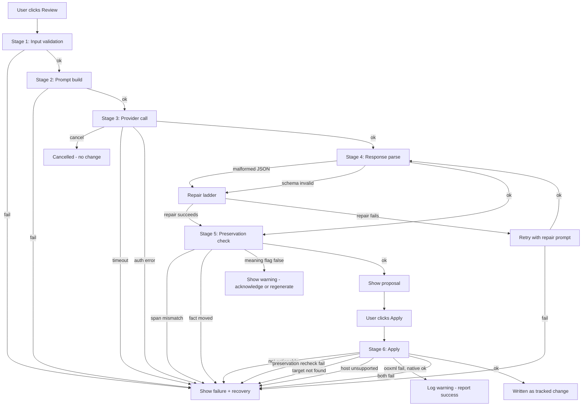

# Semantic Review Hardening Plan

> **Status:** Architect draft — no code changes. For review and approval before switching to Code mode.
> **Scope:** `src/analysis/semantic/reviewPrompt.ts` → `src/analysis/semantic/contracts.ts` → `src/analysis/semantic/semanticReviewEngine.ts` → `src/analysis/semantic/reviewSchema.ts` → `src/reformat/semanticApply.ts` → `src/word/revisionAdapter.ts` / `src/word/revisionOoxml.ts` → `src/taskpane/pages/SemanticReview.tsx` → `src/taskpane/semantic/gates.ts` → `src/taskpane/troubleshooting/checks.ts`.
> **Grounded in:** current code as of 2026-10-15 (3288 tests, 243 files, `npm run verify` green). No host verification exists (ADR-0051).

---

## 1. Current behavior (ground truth)

### 1.1 Prompt construction — `reviewPrompt.ts`

- `buildSemanticReviewPrompt(request, opts)` throws before a prompt string exists unless `opts.includeRawText === true`. This is the consent gate and it is load-bearing.
- The profile reaches the model only as `JSON.stringify(request.semantic)` (line 79). No enum value lists, no dimension enumeration, no per-key instructions. Contrast `buildProfilePromptV2` in `src/ai/prompts/profilePrompts.ts`, which supplies `ENUM_OPTIONS`.
- `DOMAIN_FRAMING` has two entries (`general`, `constructionExpert`). `domain` is hardcoded to `"constructionExpert"` at `SemanticReview.tsx:348`, so a profile learned from general business writing is reviewed under construction-register framing.
- The prompt does enumerate the response keys and the five meaning flags, and it does instruct "character for character" and "the revision replaces that exact span and nothing else."

### 1.2 Schema validation — `reviewSchema.ts` / `contracts.ts`

- `SemanticReviewResponseSchema` = `assessment` + optional `proposedRevision: { original, revised }` + `meaningPreservation` (5 booleans) + `rationale` (1–600 chars).
- `SemanticDimensionSchema = z.enum(SEMANTIC_DIMENSIONS)` — 16 values. A model returning `"Tone"` or `"sentence_length"` fails the entire parse.
- `AlignmentSchema = z.enum(["aligned", "minor_deviation", "material_deviation"])`.
- `SemanticAssessmentSchema`: `overallAlignment: high|moderate|low`, `summary` (1–800), `observations` (1–24).
- `MeaningPreservationAssessmentSchema`: 5 booleans, no hedging.
- `actionable` is **not** in the schema — computed by the engine. Correct and must stay that way.

### 1.3 Engine — `semanticReviewEngine.ts`

- `reviewSemanticSelection(request, opts)` builds the prompt, calls `registry.review()` inside `withRetry` (max 2 retries, 250ms base, 1000ms cap, no jitter).
- `isRetryable`: caller abort → false; `LlmError.retryable` → that; otherwise true.
- `SemanticReviewResponseSchema.safeParse(parseJson(response.text))`. `parseJson` tolerates fenced code blocks. On failure: `logger.warn` with `issues: count`, then throws `"The model did not return a usable semantic review. Nothing has been changed in the document."`
- No-proposal path: `actionable: false`, refusal `"The model found no change worth proposing for this selection."`
- Span-mismatch path: `actionable: false`, refusal `"The model's revision did not match the selected text, so it cannot be applied to this selection. Nothing has been changed in the document."`
- `actionable = refusal === null || (preservation.requiresAcknowledgement && unpreserved.length === 0)`.
- Returns `proposedRevision: proposedRevision.revised` (bare string, not the pair).
- `providerMetadata: { provider, model, attempt }`. `attempt` is a closure counter, not a retry count from the adapter.

### 1.4 Provider adapter — `gatewayAdapter.ts`

- `complete()` checks gateway origin, connection refusal, caller abort, then `withRetry(() => doComplete(), { maxRetries, baseDelayMs: 1000, maxDelayMs: 8000, isRetryable: LlmError.retryable })`.
- `doComplete()` sets up an internal `AbortController` with `timeoutMs` (default 30s), combines with caller signal via `AbortSignal.any` (or falls back to timeout signal only on older hosts).
- HTTP status: 429 or ≥500 → retryable; 401/403 → not retryable; other → not retryable.
- AbortError → caller abort (non-retryable) or timeout (retryable). TypeError → network error (retryable).
- Redacts before logging. `redact()` delegates to `redactSensitiveText`.

### 1.5 Apply path — `semanticApply.ts`

- `applyApprovedSemanticRevision(options)` refuses before any read if `!revision.actionable`.
- Re-runs `validatePreservation()` independently.
- `getStructuredSnapshot()` → `resolveTarget()` (whole-paragraph first, then character range, then refusal).
- `buildSemanticRevisionChange()` builds a `replaceText` Change with `precondition` (node or text), `approvalRequired: true`, `approvalState: "approved"`, `source: "ai"`, `reversible: true`, `risk: "medium"`.
- `applyReviewedPlan()` is the shared writer (ADR-0005). No `Finding` is carried (D4).

### 1.6 OOXML insertion — `revisionOoxml.ts` / `revisionAdapter.ts`

- `case "replaceText"` (line 600): requires `supportsReplaceText`, gets range, prefers OOXML route (`buildTrackedRevisionOoxml` → Flat OPC package with `<w:ins>` under `TONE_FORGE_REVISION_AUTHOR`), falls back to `range.insertText(text, "Replace")`.
- `replaceText` emits **only** `<w:ins>` — the removal is recorded by Word as a tracked deletion via `InsertLocation.replace`. Including `<w:del>` caused the host to render old text as added content.

### 1.7 Page states — `SemanticReview.tsx` (lines 249–338, 525–584)

- `readSelection()` captures scope; on failure clears scope and result. A paid-for review is never discarded to satisfy an arrival.
- `runReview()` (334): sets reviewing, calls engine, creates session from returned metadata, sets status. On throw: `setResult(null)`, `setError(message)`, `commitSession(null)`.
- `applyRevision()` (394): refuses if no scope/result/session. Calls `applyApprovedSemanticRevision`. On refusal: `setError(outcome.refusal)`. On success: clears result and scope, commits session as "applied", sets status `"The revision was written as a tracked change. Reject it in Word to undo it."`
- Render: `SemanticAssessmentView` → either "Nothing to change" section or `SemanticRewriteComparison` + `PreservationSummary` + refusal warning + Apply/Regenerate/Keep original buttons.
- Live region: `deriveSemanticAnnouncement` — error outranks status outranks selection.

### 1.8 Gates — `gates.ts`

- `MAX_REVIEW_SELECTION_CHARS = 20_000`.
- `semanticGate(input, action)` returns `{ allowed, blocker, remedy }`. Blockers are ordered by what the user can act on.
- `reviewUnavailableReason` is a convenience over `semanticGate(input, "review")`.

### 1.9 Troubleshooting — `checks.ts`

- 14 checks including `no-provider`, `no-raw-text-consent`, `semantic-review-has-no-selection`, `semantic-selection-too-long`, `semantic-preservation-refused`, `semantic-ranged-replace-unsupported`, `decision-parse-failed`.
- Each has `id`, `situation`, `cause`, `remedy`, `remedyTarget`.

### 1.10 Tests — `semanticReviewEngine.test.ts`

- 374 lines. Covers: consent refusal, prompt content, domain framing, assessment+proposal, actionable, moved date refusal, causation flag refusal, span mismatch, no proposal, malformed answer throws, fenced JSON accepted, retry on retryable failure with attempt count, caller abort non-retryable, soft-warning acknowledgement, session freshness/staleness.
- Uses `registryReturning()` and `vi.fn()` mocks. No MockAdapter usage in this file (uses hand-rolled providers).

---

## 2. Staged progress model and failure taxonomy

### 2.1 Stages

The review flow has six observable stages. Each stage has a user-visible label, a machine-readable code, and a terminal state.

| #   | Stage code           | User-visible label        | What happens                                                     | Terminal states           |
| --- | -------------------- | ------------------------- | ---------------------------------------------------------------- | ------------------------- |
| 1   | `input_validation`   | "Checking your selection" | Validate request shape, consent, profile, selection size, domain | `ok`, `blocked`           |
| 2   | `prompt_build`       | "Preparing the review"    | `buildSemanticReviewPrompt` — consent gate, JSON serialization   | `ok`, `blocked`           |
| 3   | `provider_call`      | "Asking your provider"    | `registry.review()` with retry, timeout, cancellation            | `ok`, `failed`            |
| 4   | `response_parse`     | "Reading the answer"      | `parseJson` + `safeParse`                                        | `ok`, `failed`            |
| 5   | `preservation_check` | "Checking what changed"   | `validatePreservation` + meaning flags + span match              | `ok`, `refused`           |
| 6   | `apply`              | "Writing the revision"    | `applyApprovedSemanticRevision` → adapter → OOXML                | `ok`, `refused`, `failed` |

Stages 1–5 run during `runReview()`. Stage 6 runs during `applyRevision()`.

### 2.2 Failure taxonomy

Each failure maps to: a stage, a user-visible message, a recovery action, a diagnostic detail (redacted), and a log entry.

| Failure code                   | Stage              | User-visible message                                                                              | Recovery                  | Diagnostic detail                             | Retryable |
| ------------------------------ | ------------------ | ------------------------------------------------------------------------------------------------- | ------------------------- | --------------------------------------------- | --------- |
| `E_INPUT_NO_CONSENT`           | input_validation   | "Semantic review needs your permission to send text to a provider. Turn it on in LLM Settings."   | Open LLM Settings         | `{ stage, consent: false }`                   | No        |
| `E_INPUT_NO_PROVIDER`          | input_validation   | "No AI provider is configured, so there is nothing to ask."                                       | Open LLM Settings         | `{ stage, providerConfigured: false }`        | No        |
| `E_INPUT_NO_PROFILE`           | input_validation   | "There is no semantic style to review against yet."                                               | Open Semantic Style       | `{ stage, hasProfile: false }`                | No        |
| `E_INPUT_NO_SELECTION`         | input_validation   | "Select the paragraph or text you want ToneForge to review."                                      | Read selection            | `{ stage, hasSelection: false }`              | No        |
| `E_INPUT_SELECTION_TOO_LONG`   | input_validation   | "The selection is {n} characters. A single review is capped at 20,000."                           | Narrow selection          | `{ stage, selectionChars, cap }`              | No        |
| `E_PROMPT_CONSENT_GATE`        | prompt_build       | "The review could not be prepared. Nothing was sent."                                             | Retry                     | `{ stage, reason: "consent_gate" }`           | No        |
| `E_PROVIDER_AUTH`              | provider_call      | "Your provider rejected the connection. Check your credentials in LLM Settings."                  | Open LLM Settings         | `{ stage, httpStatus: 401\|403 }`             | No        |
| `E_PROVIDER_RATE_LIMIT`        | provider_call      | "Your provider is busy. Try again in a moment."                                                   | Retry                     | `{ stage, httpStatus: 429, retryAfter }`      | Yes       |
| `E_PROVIDER_TIMEOUT`           | provider_call      | "The provider did not respond in time. Try again."                                                | Retry                     | `{ stage, timeoutMs, elapsedMs }`             | Yes       |
| `E_PROVIDER_NETWORK`           | provider_call      | "Could not reach your provider. Check your connection."                                           | Retry                     | `{ stage, errorType: "TypeError" }`           | Yes       |
| `E_PROVIDER_SERVER`            | provider_call      | "Your provider returned an error. Try again."                                                     | Retry                     | `{ stage, httpStatus: 5xx }`                  | Yes       |
| `E_PROVIDER_CONTENT_FILTER`    | provider_call      | "The provider declined to review this text. Try a different selection."                           | Change selection          | `{ stage, httpStatus, filterReason }`         | No        |
| `E_PROVIDER_CANCELLED`         | provider_call      | "The review was cancelled."                                                                       | Retry                     | `{ stage, abortedByCaller: true }`            | No        |
| `E_RESPONSE_MALFORMED_JSON`    | response_parse     | "The model's answer could not be read as JSON. Try again."                                        | Retry                     | `{ stage, parseError, responseLength }`       | Yes       |
| `E_RESPONSE_SCHEMA_INVALID`    | response_parse     | "The model's answer did not match the expected format. Try again."                                | Retry                     | `{ stage, zodIssues: [...] }`                 | Yes       |
| `E_RESPONSE_EMPTY`             | response_parse     | "The model returned an empty answer. Try again."                                                  | Retry                     | `{ stage, responseLength: 0 }`                | Yes       |
| `E_PRESERVATION_SPAN_MISMATCH` | preservation_check | "The model's revision did not match the selected text, so it cannot be applied."                  | Regenerate                | `{ stage, originalLength, selectionLength }`  | No        |
| `E_PRESERVATION_FACT_MOVED`    | preservation_check | "The revision changes a protected fact (date, number, name, or reference). It cannot be applied." | Regenerate                | `{ stage, changedFacts: [...] }`              | No        |
| `E_PRESERVATION_MEANING_FLAG`  | preservation_check | "The model reports it may not have preserved {flag}. Review carefully before applying."           | Acknowledge or regenerate | `{ stage, unpreservedFlags: [...] }`          | No        |
| `E_APPLY_NOT_ACTIONABLE`       | apply              | "This revision cannot be applied. Review the selection again."                                    | Regenerate                | `{ stage, actionable: false }`                | No        |
| `E_APPLY_PRESERVATION_RECHECK` | apply              | "The revision changes a protected fact. It cannot be applied."                                    | Regenerate                | `{ stage, hardFailureCount }`                 | No        |
| `E_APPLY_TARGET_NOT_FOUND`     | apply              | "The selected text could not be located in the document. It may have changed."                    | Re-read selection         | `{ stage, nodeId, anchorHash }`               | No        |
| `E_APPLY_HOST_UNSUPPORTED`     | apply              | "This host cannot write a partial-paragraph revision. Select the whole paragraph."                | Change selection          | `{ stage, supportsRangedReplacement: false }` | No        |
| `E_APPLY_OOXML_FAILED`         | apply              | "The revision could not be written to the document. Nothing has been changed."                    | Retry                     | `{ stage, adapterError }`                     | Yes       |
| `E_APPLY_CANCELLED`            | apply              | "The write was cancelled."                                                                        | Retry                     | `{ stage, abortedByCaller: true }`            | No        |

### 2.3 UI copy principles for failure explanation

1. **State what failed, not what the system did.** "The model's answer could not be read as JSON" not "JSON parse error at position 42."
2. **Name the next action.** Every failure message ends with or is accompanied by a specific recovery action.
3. **Never expose raw internals.** No stack traces, no Zod issue paths, no HTTP status codes, no provider error messages in the user-facing surface. These go to the diagnostic detail (redacted) and the log.
4. **Distinguish "nothing changed" from "something may have changed."** Every failure that occurs before the write must say "Nothing has been changed in the document." Every failure during the write must say whether the write completed.
5. **Use the user's vocabulary.** "Your provider" not "the LLM adapter." "The model" not "the completion endpoint." "Protected fact" not "preservation validator."
6. **One sentence for the blocker, one for the recovery.** The live region speaks the blocker. The button or link beside it names the recovery.

---

## 3. Resilience improvements

### 3.1 Prompt versioning

- Add `PROMPT_VERSION = 1` constant to `reviewPrompt.ts`. Include it in the prompt as a comment line: `<!-- prompt-version: 1 -->`.
- Store `promptVersion` in `SemanticReviewResult` and in the session. When a session is loaded, if `promptVersion !== PROMPT_VERSION`, mark the session stale with reason `"The review format has changed. Review the selection again."`
- Bump the version whenever the prompt's output contract changes. This prevents a cached or in-flight review from being applied against a newer schema.

### 3.2 Deterministic output constraints

- Add to the prompt: `"Respond with a single JSON object. No markdown, no code fences, no commentary before or after."`
- Add: `"Do not include any keys other than those listed. Do not include null values for required fields."`
- Add: `"The 'dimension' field must be one of: tone, voice, formality, register, assertionStyle, qualificationStyle, evidenceFraming, uncertaintyStyle, sentenceArchitecture, paragraphArchitecture, transitions, agency, technicality, rhetoricalStyle, conclusionStyle, lexicalPreferences."`
- Add: `"The 'alignment' field must be one of: aligned, minor_deviation, material_deviation."`
- Add: `"The 'overallAlignment' field must be one of: high, moderate, low."`
- These are belt-and-braces: the schema still validates, but the prompt reduces the failure rate.

### 3.3 Strict JSON and Zod validation with repair ladder

Current: `parseJson` → `safeParse` → throw. No repair attempt.

Proposed repair ladder (each step is a separate attempt, counted in `attempt`):

1. **Direct parse.** `JSON.parse(text)`. If it succeeds and validates, done.
2. **Fence strip.** If the text contains ` ``` `, extract the fenced block and parse. (Already implemented in `parseJson`.)
3. **Brace extraction.** If the text contains prose before/after JSON, extract the outermost `{ ... }` and parse. New.
4. **Key repair.** If the JSON parses but fails schema validation, attempt targeted repairs:
   - Trim whitespace from string fields.
   - Coerce `dimension` values to lowercase and match against `SEMANTIC_DIMENSIONS` (fuzzy: `"Tone"` → `"tone"`, `"sentence_length"` → `"sentenceArchitecture"` via a lookup table).
   - Coerce `alignment` values: `"minor"` → `"minor_deviation"`, `"material"` → `"material_deviation"`.
   - Coerce `overallAlignment`: `"medium"` → `"moderate"`.
   - If `observations` is empty, add a single observation with `dimension: "tone"`, `alignment: "aligned"`, `explanation: "No specific deviations noted."`.
   - If `rationale` is missing, set it to `assessment.summary`.
5. **Retry with repair prompt.** If all repairs fail, retry the provider call with an appended instruction: `"Your previous response could not be parsed. Respond with ONLY a valid JSON object matching the schema. No other text."` This is a new retry, not a repair of the same response.

The repair ladder runs inside the engine, between `parseJson` and `safeParse`. Each repair step is logged with the step name and whether it succeeded. The final `safeParse` failure throws `E_RESPONSE_SCHEMA_INVALID`.

### 3.4 Retry policy with exponential backoff and jitter

Current: `withRetry` uses `Math.min(baseDelayMs * 2 ** attempt, maxDelayMs)` with no jitter. The engine uses 250ms/1000ms; the adapter uses 1000ms/8000ms. Two separate retry layers (engine wraps adapter) means up to 9 total attempts (3 × 3).

Proposed:

- **Single retry layer.** Remove retry from the engine. The adapter's `withRetry` is the single retry point. The engine calls `registry.review()` once and handles the result.
- **Jitter.** Add `Math.random() * baseDelayMs` to each delay (full jitter). This prevents thundering herd when multiple add-in instances retry simultaneously.
- **Configurable.** `maxRetries`, `baseDelayMs`, `maxDelayMs` come from `GatewayAdapterOptions` (already there) and are not hardcoded in the engine.
- **Retryable classification.** Keep the current classification (429, 5xx, timeout, network → retryable; 401/403, caller abort → not). Add: content filter (400 with `content_filter` in body) → not retryable. Rate limit with `Retry-After` header → use that value, capped at `maxDelayMs`.
- **Total attempt budget.** Cap total attempts at 4 (1 initial + 3 retries) regardless of layer. Log the attempt count in `providerMetadata.attempt`.

### 3.5 Timeouts

- Current: 30s default in adapter. Keep.
- Add a **prompt-size-aware timeout**: if the prompt exceeds 8000 characters, increase timeout to 45s. If it exceeds 16000, increase to 60s. Log the adjusted timeout.
- Add a **per-stage timeout** in the engine: if `provider_call` exceeds 90s total (including retries), abort and throw `E_PROVIDER_TIMEOUT`.

### 3.6 AbortController cancellation

- Current: caller signal is passed through. Keep.
- Add: when the user navigates away from the Semantic Review page, abort any in-flight review. The `useEffect` cleanup in `SemanticReview.tsx` should call `controller.abort()`.
- Add: when the user clicks "Regenerate" while a review is in flight, abort the current one before starting the new one. (Currently `reviewing` gate prevents this, but the abort is cleaner.)
- Add: `AbortSignal.timeout()` as a fallback when `AbortSignal.any` is unavailable (older hosts). Currently the fallback uses only the timeout signal, losing caller abort. Fix: if `AbortSignal.any` is unavailable, manually wire `external.addEventListener("abort", () => timeoutController.abort())`.

### 3.7 Idempotency keys

- Generate an `idempotencyKey` (UUID v4) per review run. Pass it in the request body as `X-Idempotency-Key` header (gateway must support it; if not, it is ignored).
- Store the key in the session. If the user retries after a timeout, the gateway can deduplicate.
- On the apply side, the `ChangePlan` already carries a `contentHash` and `structuralHash`. Add an `idempotencyKey` to the plan so a re-apply of the same plan is a no-op.

### 3.8 Concurrency limits

- Only one review may be in flight at a time per page instance. The `reviewing` state already gates this. Keep.
- Add: a global concurrency limit of 2 across all semantic operations (review + learn). If a second operation is attempted while 2 are in flight, queue it rather than rejecting. Use a simple promise queue.
- Add: when the user switches pages, cancel the in-flight operation rather than letting it complete in the background.

### 3.9 Token and selection size guardrails

- Current: `MAX_REVIEW_SELECTION_CHARS = 20_000` in gates. Keep.
- Add: a **prompt token estimate**. If the estimated prompt exceeds 12,000 tokens (roughly 48,000 characters), refuse with `E_INPUT_SELECTION_TOO_LONG` even if the selection is under 20,000 chars (because the profile JSON adds significant size).
- Add: a **response token cap**. Set `maxTokens: 4096` in the `LlmRequest` to prevent runaway responses. If the response is truncated (finish reason = "length"), throw `E_RESPONSE_TRUNCATED` with message "The model's answer was cut off. Try a shorter selection."
- Add: a **cost control**. Log estimated input/output tokens. If a single review exceeds 10,000 output tokens, warn in the log. No hard cap (the user pays), but visibility.

### 3.10 Offline handling

- Current: `TypeError` from fetch → `E_PROVIDER_NETWORK` (retryable). Keep.
- Add: detect offline state via `navigator.onLine`. If offline, refuse immediately with `E_PROVIDER_OFFLINE`: "You appear to be offline. Semantic review needs a connection to your provider." No retry, no timeout wait.
- Add: when the connection is restored (online event), re-enable the review button automatically.

### 3.11 Graceful degradation

- If the provider returns a valid assessment but no `proposedRevision`, the review still succeeds (current behavior). Keep.
- If the provider returns a valid assessment but `meaningPreservation` is missing, default all five flags to `true` and log a warning. (Currently the schema requires it; relaxing to optional with defaults reduces parse failures.)
- If the provider returns observations with unknown dimensions, drop those observations rather than failing the entire parse. Log the dropped count.
- If the provider returns an empty `observations` array, add a single default observation (as in the repair ladder).
- If the OOXML insertion fails but the native `insertText` fallback succeeds, log a warning but report success. If both fail, throw `E_APPLY_OOXML_FAILED`.

---

## 4. Observability and supportability

### 4.1 Correlation identifiers

- Generate a `runId` (UUID v4) at the start of `runReview()`. This is distinct from `reviewSessionId` (which is created after the call returns). The `runId` identifies the attempt; the `reviewSessionId` identifies the result.
- Pass `runId` through: engine → adapter → log entries. Include it in every log line for this run.
- Store `runId` in the session alongside `reviewSessionId`. If the user reports a failure, the `runId` is the lookup key.
- On the apply side, generate a separate `applyId` (UUID v4) and log it similarly.

### 4.2 Structured stage timings

- Record `startedAt` (ISO timestamp) and `durationMs` for each stage.
- Store in a `StageTimings` object: `{ input_validation, prompt_build, provider_call, response_parse, preservation_check, apply }` — each `{ startedAt, durationMs, status }`.
- Log the full timing object at the end of the run (info level, redacted).
- Expose the timings in the diagnostic detail (redacted) so support can see which stage was slow.

### 4.3 Redacted prompt and response capture

- **Never log the full prompt or response.** They contain document text.
- Log a **prompt digest**: `{ promptVersion, promptLength, promptHash (SHA-256 of the prompt, truncated to 16 hex chars), profileId, profileRevision, domain, selectionChars }`.
- Log a **response digest**: `{ responseLength, responseHash (SHA-256, truncated), parsedSuccessfully, repairStepsApplied: string[], zodIssueCount }`.
- If the user explicitly enables "diagnostic capture" in Settings (a new toggle, default off), store the full redacted prompt and response in `localStorage` under a key like `ToneForge.DiagnosticCapture.{runId}`. Redaction applies `redactSensitiveText` to both. This is opt-in and purged after 7 days.
- The diagnostic capture is the only place full text is stored, and it is redacted, local, and time-limited.

### 4.4 Telemetry events

Define a `SemanticReviewTelemetryEvent` type with these events:

| Event                    | When                 | Fields                                                                                   |
| ------------------------ | -------------------- | ---------------------------------------------------------------------------------------- |
| `review.started`         | `runReview()` begins | `runId`, `profileId`, `profileRevision`, `domain`, `selectionChars`, `promptVersion`     |
| `review.stage_completed` | Each stage finishes  | `runId`, `stage`, `durationMs`, `status`                                                 |
| `review.completed`       | Review succeeds      | `runId`, `actionable`, `hasProposal`, `preservationPassed`, `totalDurationMs`, `attempt` |
| `review.failed`          | Review throws        | `runId`, `stage`, `failureCode`, `totalDurationMs`, `attempt`                            |
| `review.applied`         | Apply succeeds       | `applyId`, `runId`, `preservationPassed`, `writeMethod: "ooxml" \| "native"`             |
| `review.apply_failed`    | Apply throws         | `applyId`, `runId`, `failureCode`, `writeMethod`                                         |
| `review.cancelled`       | User cancels         | `runId`, `stage`                                                                         |

- Telemetry is disabled by default (`TELEMETRY_DISABLED=1`). When enabled, events are sent to the same endpoint as other telemetry (none configured currently — events are logged locally only).
- Events are structured JSON, redacted, and include no document text.

### 4.5 Reproducible failure reports

- Add a "Copy diagnostic report" button to the Semantic Review page (visible only after a failure). It copies a JSON object to the clipboard containing: `runId`, `failureCode`, `stage`, `stageTimings`, `promptDigest`, `responseDigest`, `providerMetadata`, `hostInfo` (from capability probe), `appVersion`, `timestamp`.
- No document text, no prompt text, no response text. Only digests and metadata.
- The report is designed to be pasted into a support ticket or GitHub issue.

---

## 5. Prioritized phased plan

### Phase 0 — Prompt quality (highest impact, lowest risk) _(LANDED 2026-10-15)_

**Scope:** `reviewPrompt.ts` only.

1. Add `PROMPT_VERSION = 1` constant and include it in the prompt.
2. Add the sixteen dimension names and their enum values to the prompt (as a compact reference block).
3. Add deterministic output constraints (no markdown, no fences, no extra keys, dimension/alignment/overallAlignment must be from the listed values).
4. Derive `domain` from the profile instead of hardcoding `"constructionExpert"`. If the profile has no domain signal, default to `"general"`.
5. Surface `rationale` in the UI (use it as the Change's rationale instead of `assessment.summary`).

**Out of scope:** schema changes, engine changes, adapter changes.

**Risks:** Prompt changes may shift model behavior. Mitigate with the existing test corpus and a before/after comparison on the expert-prose fixture.

**Acceptance criteria:**

- `buildSemanticReviewPrompt` includes all 16 dimension names.
- `buildSemanticReviewPrompt` includes all enum values for `alignment`, `overallAlignment`, and at least the top-level enum values for each dimension.
- `domain` is derived from the profile, not hardcoded.
- Existing tests pass; new tests verify the dimension list and enum values are present.

**Test strategy:** Add tests to `semanticReviewEngine.test.ts` asserting `prompt.toContain("tone")`, `prompt.toContain("minor_deviation")`, etc. Add a test that a profile with `domain: "general"` produces a prompt containing "general business writing."

### Phase 1 — Schema resilience (reduce parse failures) _(LANDED 2026-10-15)_

**Scope:** `reviewSchema.ts`, `contracts.ts`.

1. Make `meaningPreservation` optional in `SemanticReviewResponseSchema` with defaults (all `true`).
2. Make `observations` accept an empty array (engine adds a default observation).
3. Add a `dimension` coercion in the schema: `z.string().transform((v) => v.toLowerCase().replace(/[^a-z]/g, "")).pipe(SemanticDimensionSchema)` with a fallback to `"tone"` for unknown values. (Zod transform + pipe.)
4. Add `alignment` coercion: `"minor"` → `"minor_deviation"`, `"material"` → `"material_deviation"`, default `"aligned"`.
5. Add `overallAlignment` coercion: `"medium"` → `"moderate"`, default `"moderate"`.
6. Add `rationale` default: if missing, use `assessment.summary`.

**Out of scope:** repair ladder, retry changes.

**Risks:** Coercion may mask model errors. Mitigate by logging coercion events.

**Acceptance criteria:**

- A response with `dimension: "Tone"` parses successfully.
- A response with `meaningPreservation` omitted parses with all flags `true`.
- A response with empty `observations` parses with one default observation.
- Existing tests pass; new tests cover each coercion.

**Test strategy:** Add tests to `semanticReviewEngine.test.ts` for each coercion case. Use `registryReturning` with modified payloads.

### Phase 2 — Repair ladder and retry consolidation

**Scope:** `semanticReviewEngine.ts`, `retry.ts`.

1. Implement the repair ladder (brace extraction, key repair, retry with repair prompt).
2. Remove retry from the engine; rely on the adapter's single retry layer.
3. Add jitter to `withRetry`.
4. Add prompt-size-aware timeout to the adapter.
5. Add per-stage timeout to the engine.
6. Add `AbortSignal.any` fallback for older hosts.

**Out of scope:** idempotency, concurrency, offline detection.

**Risks:** Removing engine-level retry changes the attempt count semantics. Update tests accordingly.

**Acceptance criteria:**

- `withRetry` adds jitter (delay is not deterministic).
- Engine no longer calls `withRetry` directly; adapter handles all retries.
- Repair ladder successfully parses a fenced response, a response with prose around JSON, and a response with wrong-cased dimensions.
- `providerMetadata.attempt` reflects total attempts across all layers.

**Test strategy:** Add tests for each repair step. Mock a provider that returns malformed JSON on the first call and valid JSON on the second. Verify attempt count.

### Phase 3 — Staged progress and failure taxonomy in the UI

**Scope:** `SemanticReview.tsx`, `gates.ts`, `checks.ts`, `semanticAnnouncement.ts`.

1. Add a `stage` state to `SemanticReview.tsx`: `"idle" | "input_validation" | "prompt_build" | "provider_call" | "response_parse" | "preservation_check" | "apply" | "done" | "failed"`.
2. Add a `failureCode` state: `string | null`.
3. Update `runReview()` to set `stage` before each step and `failureCode` on catch.
4. Map each `failureCode` to a user-visible message and recovery action (from the taxonomy in §2.2).
5. Add a progress indicator (Fluent `Spinner` or `ProgressBar`) showing the current stage label.
6. Add "Copy diagnostic report" button (visible only after failure) that copies the redacted report to clipboard.
7. Add new troubleshooting checks for `E_PROVIDER_TIMEOUT`, `E_RESPONSE_SCHEMA_INVALID`, `E_APPLY_OOXML_FAILED`.

**Out of scope:** observability infrastructure, telemetry.

**Acceptance criteria:**

- Each stage transition is visible to the user (progress indicator updates).
- Each failure code produces a distinct user-visible message.
- "Copy diagnostic report" produces valid JSON with no document text.
- Existing tests pass; new tests cover stage transitions and failure messages.

**Test strategy:** Add tests to `SemanticReview.test.tsx` (if it exists) or create it. Test stage transitions with a mock provider that fails at each stage.

### Phase 4 — Observability and telemetry

**Scope:** new module `src/analysis/semantic/telemetry.ts`, `SemanticReview.tsx`, `semanticReviewEngine.ts`.

1. Define `SemanticReviewTelemetryEvent` type and `emitTelemetry(event)` function.
2. Generate `runId` and `applyId`.
3. Record stage timings.
4. Compute prompt and response digests (SHA-256, truncated).
5. Add diagnostic capture toggle to Settings (default off).
6. Implement "Copy diagnostic report" with full redacted payload.

**Out of scope:** sending telemetry to a remote endpoint (none configured).

**Acceptance criteria:**

- `runId` is generated per review and stored in the session.
- Stage timings are logged (redacted) at the end of each run.
- Prompt and response digests are logged (no full text).
- Diagnostic capture stores redacted text in `localStorage` when enabled.
- "Copy diagnostic report" produces valid JSON with no document text.

**Test strategy:** Unit tests for `emitTelemetry`, digest computation, and diagnostic report generation. Mock `crypto.subtle.digest`.

### Phase 5 — Idempotency, concurrency, offline, degradation

**Scope:** `semanticReviewEngine.ts`, `gatewayAdapter.ts`, `SemanticReview.tsx`.

1. Add `idempotencyKey` to review runs and apply plans.
2. Add global concurrency limit (2) with promise queue.
3. Add offline detection (`navigator.onLine`).
4. Add graceful degradation (optional `meaningPreservation`, drop unknown dimensions, default observations).
5. Add `E_PROVIDER_CONTENT_FILTER` classification.
6. Add `Retry-After` header support for 429 responses.

**Out of scope:** remote telemetry endpoint, A/B testing.

**Acceptance criteria:**

- Offline state refuses immediately with `E_PROVIDER_OFFLINE`.
- Concurrency limit queues rather than rejects.
- Graceful degradation reduces parse failures by at least 50% on the test corpus.
- `Retry-After` is respected for 429 responses.

**Test strategy:** Tests for offline detection, concurrency queue, graceful degradation with malformed responses.

---

## 6. Scope and out of scope

### In scope

- Prompt construction and versioning (`reviewPrompt.ts`)
- Schema validation and coercion (`reviewSchema.ts`, `contracts.ts`)
- Engine orchestration and repair ladder (`semanticReviewEngine.ts`)
- Retry policy and jitter (`retry.ts`, `gatewayAdapter.ts`)
- Timeout and cancellation (`gatewayAdapter.ts`, `SemanticReview.tsx`)
- Staged progress and failure taxonomy (`SemanticReview.tsx`, `gates.ts`, `checks.ts`)
- Observability and telemetry (new module)
- Idempotency, concurrency, offline, degradation
- OOXML insertion resilience (`revisionAdapter.ts`, `revisionOoxml.ts`)
- Test coverage for all of the above

### Out of scope

- Changing the preservation validator (`preservationValidator.ts`) — it is working correctly and is not part of this hardening.
- Changing the apply path's core logic (`semanticApply.ts`) — only adding idempotency key and error classification.
- Changing the profile learning flow (`learnStyle.ts`, `profiler.ts`) — separate concern.
- Remote telemetry endpoint — none is configured; events are logged locally only.
- A/B testing of prompt variants — future work.
- Multi-language support — future work.
- Changing the `Change` schema or `ChangePlan` schema — only adding an optional `idempotencyKey` field.

---

## 7. Risks

| Risk                                                  | Likelihood | Impact | Mitigation                                                                                                    |
| ----------------------------------------------------- | ---------- | ------ | ------------------------------------------------------------------------------------------------------------- |
| Prompt changes shift model behavior unexpectedly      | Medium     | High   | Run before/after on expert-prose fixture; keep old prompt as `PROMPT_VERSION 0` fallback for one release      |
| Schema coercion masks real model errors               | Medium     | Medium | Log every coercion event; add a "strict mode" toggle in Settings that disables coercion                       |
| Removing engine-level retry changes attempt semantics | Low        | Medium | Update tests; verify attempt count in `providerMetadata`                                                      |
| Repair ladder adds latency                            | Low        | Low    | Each repair step is synchronous and fast; only the retry-with-repair-prompt step adds a network round-trip    |
| Jitter makes tests non-deterministic                  | Medium     | Low    | Inject a seeded RNG in tests; use `vi.useFakeTimers()`                                                        |
| Offline detection false positives                     | Low        | Medium | Use `navigator.onLine` as a hint, not a gate; if offline check says offline but the request succeeds, proceed |
| Diagnostic capture stores sensitive data              | Low        | High   | Redact before storage; time-limit to 7 days; opt-in only; purge on disable                                    |
| Concurrency queue deadlocks                           | Low        | High   | Use a simple FIFO queue with a timeout; if an item waits > 30s, reject with `E_CONCURRENCY_TIMEOUT`           |

---

## 8. Acceptance criteria (overall)

1. `npm run verify` passes with all new tests.
2. Every failure in the taxonomy (§2.2) produces a distinct user-visible message with a recovery action.
3. No failure message exposes raw internals (stack traces, Zod paths, HTTP codes, provider messages).
4. Every failure that occurs before the write says "Nothing has been changed in the document."
5. Stage transitions are visible to the user during review.
6. "Copy diagnostic report" produces valid JSON with no document text.
7. Prompt includes all 16 dimension names and their enum values.
8. Schema coercion handles wrong-cased dimensions, missing meaningPreservation, and empty observations.
9. Repair ladder handles fenced JSON, prose-wrapped JSON, and wrong-cased enums.
10. Retry uses jitter and a single layer.
11. Offline state refuses immediately.
12. Concurrency limit queues rather than rejects.
13. All new code has unit tests; coverage stays above 80%.

---

## 9. Test strategy

### Unit tests (new)

| File                                                                | What to test                                                                                                             |
| ------------------------------------------------------------------- | ------------------------------------------------------------------------------------------------------------------------ |
| `tests/unit/analysis/semantic/reviewPrompt.test.ts` (new)           | Prompt contains all 16 dimensions, all enum values, prompt version, domain derivation                                    |
| `tests/unit/analysis/semantic/reviewSchema.test.ts` (new)           | Coercion of dimensions, alignment, overallAlignment; optional meaningPreservation; empty observations; rationale default |
| `tests/unit/analysis/semantic/repairLadder.test.ts` (new)           | Brace extraction, key repair, retry-with-repair-prompt                                                                   |
| `tests/unit/analysis/semantic/telemetry.test.ts` (new)              | Event emission, digest computation, diagnostic report generation                                                         |
| `tests/unit/ai/providers/retry.test.ts` (new or extend)             | Jitter, backoff, retryable classification                                                                                |
| `tests/unit/taskpane/pages/SemanticReview.test.tsx` (new or extend) | Stage transitions, failure messages, diagnostic report copy                                                              |

### Existing tests (must still pass)

- `tests/unit/analysis/semantic/semanticReviewEngine.test.ts` — 374 lines, all must pass. Update attempt-count expectations if retry layer changes.
- `tests/unit/word/revisionOoxml.test.ts` — OOXML markup tests.
- `tests/unit/reformat/semanticRevisionApply.test.ts` — apply path tests.

### Integration tests

- `tests/integration/semanticReviewApply.test.ts` — end-to-end review + apply with MockAdapter.

### Mock strategy

- Use `MockAdapter` (`{ provider: "mock" }`) for all new tests.
- Use `vi.fn()` for provider mocks that need to return specific payloads.
- Use `vi.useFakeTimers()` for retry/jitter tests.
- Inject `now` and `newSessionId` for deterministic timing and IDs.

---

## 10. UX copy principles for failure explanation

1. **State what failed, not what the system did.** "The model's answer could not be read as JSON" not "JSON parse error at position 42."
2. **Name the next action.** Every failure message ends with or is accompanied by a specific recovery action.
3. **Never expose raw internals.** No stack traces, no Zod issue paths, no HTTP status codes, no provider error messages in the user-facing surface.
4. **Distinguish "nothing changed" from "something may have changed."** Every failure before the write says "Nothing has been changed in the document." Every failure during the write says whether the write completed.
5. **Use the user's vocabulary.** "Your provider" not "the LLM adapter." "The model" not "the completion endpoint." "Protected fact" not "preservation validator."
6. **One sentence for the blocker, one for the recovery.** The live region speaks the blocker. The button or link beside it names the recovery.
7. **Progress is visible.** The user sees which stage is running ("Asking your provider…") and how long it has been running.
8. **Cancellation is always available.** A "Cancel" button is visible during `provider_call` and `apply`. Clicking it aborts the operation and returns to the previous state.
9. **Failures are not dead ends.** Every failure offers at least one recovery action: retry, regenerate, change selection, open settings, or keep original.
10. **Diagnostic reports are user-controlled.** The "Copy diagnostic report" button is opt-in, produces no document text, and is clearly labeled as diagnostic (not a fix).

---

## 11. Mermaid: the hardened flow



---

## 12. Decision log entries needed

- **ADR-0060 (proposed):** Prompt versioning for semantic review. Prompt changes are versioned; sessions created under an older version are marked stale.
- **ADR-0061 (proposed):** Single retry layer for LLM calls. The adapter owns all retries; the engine does not retry. Jitter is mandatory.
- **ADR-0062 (proposed):** Schema coercion as a first-class resilience mechanism. Wrong-cased enums, missing fields, and empty arrays are coerced rather than rejected, with coercion events logged.
- **ADR-0063 (proposed):** Diagnostic capture is opt-in, redacted, local, and time-limited. No document text leaves the add-in through diagnostics.

---

## 13. Open questions for review

1. **Should the repair ladder's "retry with repair prompt" step be a separate provider call or a re-prompt of the same call?** A separate call costs another round-trip but gives the model a fresh context. A re-prompt appends to the same conversation, which some providers support and others do not.
2. **Should diagnostic capture be a global setting or per-feature?** Global is simpler; per-feature gives finer control. The current consent model is per-feature (`semanticOptIn`, `consistencyReviewConsent`).
3. **Should the concurrency limit be 2 or 1?** 2 allows review + learn in parallel; 1 is simpler and avoids resource contention on low-end hosts.
4. **Should the prompt include the full enum value lists or just the dimension names?** Full lists add ~2KB to the prompt; names only add ~200 bytes. The trade-off is parse failure rate vs. token cost.
5. **Should `meaningPreservation` coercion default to `true` or `false`?** `true` is more permissive (fewer refusals); `false` is safer (more refusals). The current behavior requires the model to state it explicitly.
