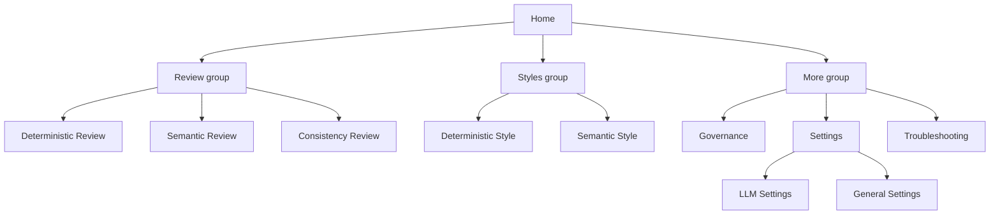

# ToneForge Unified Fluent v9 UI/UX Implementation Plan

> **Status:** Proposed. Awaiting approval before implementation.
>
> **Input documents:**
> [`ToneForge_HOME_AND_UNIFIED_FLUENT_UX_IMPLEMENTATION.md`](../systematic review/ToneForge_HOME_AND_UNIFIED_FLUENT_UX_IMPLEMENTATION.md) (the target spec)
> and [`ToneForge_LLM_SETTINGS_SYSTEMATIC_IMPLEMENTATION.md`](../systematic review/ToneForge_LLM_SETTINGS_SYSTEMATIC_IMPLEMENTATION.md) (the LLM settings split).
>
> **Canonical governance:** [`ROADMAP.md`](../ROADMAP.md) is the status ledger; [`docs/architecture.md`](../docs/architecture.md) is the module-boundary authority; [`docs/decision-log.md`](../docs/decision-log.md) records the ADRs this plan creates.

---

## 0. Locked scope decisions

These were confirmed by the product owner and are not open questions. Everything below follows from them.

| #      | Decision                                                                                                                                                                                                                                                                                                                                                                                                                                      |
| ------ | --------------------------------------------------------------------------------------------------------------------------------------------------------------------------------------------------------------------------------------------------------------------------------------------------------------------------------------------------------------------------------------------------------------------------------------------- |
| **L1** | **Adopt the spec in full**, including the Review / Styles / More navigation hierarchy, the route renames, the command-centre Home page, and ribbon realignment.                                                                                                                                                                                                                                                                               |
| **L2** | **Migrate Fluent v8 to v9 first** ([`@fluentui/react`](../package.json:48) → `@fluentui/react-components` + `@fluentui/react-icons`), then migrate pages against v9 primitives.                                                                                                                                                                                                                                                               |
| **L3** | **The settings split is preserved as an existing structural reality.** The spec's single `Settings` item becomes a `Settings` group containing the two already-separated pages: [`LlmSettings.tsx`](../src/taskpane/pages/LlmSettings.tsx:9) and [`GeneralSettings.tsx`](../src/taskpane/pages/GeneralSettings.tsx:22). This is the one structural divergence from the spec's literal navigation text, and it is the split the mandate named. |
| **L4** | **No functionality is removed.** Reviews, apply paths, gates, persistence, and the single mutation path are untouched. This plan replaces _presentation and navigation_, not behaviour.                                                                                                                                                                                                                                                       |

### 0.1 Scope boundary — formatting vs. new behaviour

Most of the spec is a reskin. A minority of it is **new behaviour**. Those items are in scope (L1) but are called out here because they are not "formatting replacement" and must be implemented deliberately rather than as a side effect:

| Item                                                    | Spec §   | Nature                                                                                 |
| ------------------------------------------------------- | -------- | -------------------------------------------------------------------------------------- |
| Home reads and renders live state for all three reviews | §8, §11  | New view over existing state; **Home must not become a second state owner** (§48).     |
| `ReviewModeCard` shared contract                        | §10      | New component.                                                                         |
| Global status vocabulary + `StatusBadge`                | §14, §15 | New shared presentation over existing statuses.                                        |
| Setup card replacing the current setup checklist Home   | §13      | Reshape of existing [`Home.tsx`](../src/taskpane/pages/Home.tsx:35).                   |
| Consistency analysis storage control                    | §30.1    | Only if the underlying retained-analysis store exists; otherwise deferred (see §11.4). |
| Fluent `Toast` for transient confirmation               | §20      | New; no toast exists today.                                                            |
| Fluent `Dialog` for destructive actions                 | §19, §46 | New confirmation gate over existing destructive buttons.                               |

---

## 1. Current-state audit

This section is the systematic review the mandate asked for: every non-Fluent instance, where it lives, and what replaces it.

### 1.1 The version gap (the finding the spec misses)

The spec is written against **Fluent v9** (`@fluentui/react-components`): it names `FluentProvider`, `Card`/`CardHeader`, `Badge`, `Toast`/`Toaster`, `Accordion`, `makeStyles`, `tokens.*`, and "Fluent System Icons". The repository is on **Fluent v8** ([`@fluentui/react`](../package.json:48)). Under v8 none of `Card`, `Toast`, `Accordion`, or `makeStyles` exist, and icons are font icons named by string. **Every primitive in the spec therefore has no v8 home, which is why L2 migrates first.** Until v9 lands, no page can be migrated to the spec's vocabulary.

Current v8 usage to be ported (import sites):

| v8 API in use                    | Files                                                                                                                                                                                                                                                                                                                                                                           | v9 replacement                                                      |
| -------------------------------- | ------------------------------------------------------------------------------------------------------------------------------------------------------------------------------------------------------------------------------------------------------------------------------------------------------------------------------------------------------------------------------- | ------------------------------------------------------------------- |
| `ThemeProvider`, `createTheme`   | `theme.tsx`, `fluentTheme.ts`                                                                                                                                                                                                                                                                                                                                                   | `FluentProvider` + `createLightTheme` / `createDarkTheme`           |
| `PrimaryButton`, `DefaultButton` | 8 files incl. [`SettingsSectionCard.tsx`](../src/taskpane/components/SettingsSectionCard.tsx:2)                                                                                                                                                                                                                                                                                 | `Button` with `appearance="primary"` / `"secondary"`                |
| `IconButton`                     | [`TaskPaneHeader.tsx`](../src/taskpane/components/TaskPaneHeader.tsx:2)                                                                                                                                                                                                                                                                                                         | `Button appearance="subtle" icon=...` / `ToolbarButton`             |
| `TextField`                      | [`ProfileEditor.tsx`](../src/taskpane/components/ProfileEditor.tsx:9), [`SemanticProfileEditor.tsx`](../src/taskpane/components/SemanticProfileEditor.tsx:29), [`GovernancePolicySection.tsx`](../src/taskpane/components/GovernancePolicySection.tsx:9), [`OpenRouterConnectionSettings.tsx`](../src/taskpane/components/OpenRouterConnectionSettings.tsx:2)                   | `Field` + `Input` / `Textarea`                                      |
| `Dropdown`, `ComboBox`           | [`DecisionFallbackPolicyControl.tsx`](../src/taskpane/components/DecisionFallbackPolicyControl.tsx:2), [`StylingSettingsSection.tsx`](../src/taskpane/components/StylingSettingsSection.tsx:2), [`ModelPicker.tsx`](../src/taskpane/components/ModelPicker.tsx:8)                                                                                                               | `Dropdown` / `Combobox` + `Option`                                  |
| `Toggle`                         | [`RedactionSettingsSection.tsx`](../src/taskpane/components/RedactionSettingsSection.tsx:2), [`ScanningSettingsSection.tsx`](../src/taskpane/components/ScanningSettingsSection.tsx:15), [`TrackedEditingSettingsSection.tsx`](../src/taskpane/components/TrackedEditingSettingsSection.tsx:2), [`RoleConnectionCard.tsx`](../src/taskpane/components/RoleConnectionCard.tsx:2) | `Switch`                                                            |
| `MessageBar`, `MessageBarType`   | 7 files incl. [`SettingsDashboard.tsx`](../src/taskpane/components/SettingsDashboard.tsx:2), [`ExportChangesButton.tsx`](../src/taskpane/components/ExportChangesButton.tsx:1)                                                                                                                                                                                                  | `MessageBar` + `MessageBarBody` + `MessageBarActions` with `intent` |
| `iconProps={{ iconName }}`       | [`TaskPaneHeader.tsx`](../src/taskpane/components/TaskPaneHeader.tsx:138)                                                                                                                                                                                                                                                                                                       | `@fluentui/react-icons` SVG components                              |

### 1.2 Native controls (the largest single category)

**96 native elements** rendered across the pane. Every one was a hand-styled control the spec forbids when a Fluent equivalent exists. They carried the `nativeFieldProps` / `nativeButtonProps` markers (`src/taskpane/nativeField.ts`, since deleted), which was the exact seam the migration removed from. **P5 is complete:** the marker module, its CSS rules, and every native `button`/`select`/`textarea` are gone; the guard now asserts the _absence_ of `.tf-native*`.

| Element                                          | Count | Representative sites                                                                                                                                                                                                                                                                      | v9 replacement                                       |
| ------------------------------------------------ | ----- | ----------------------------------------------------------------------------------------------------------------------------------------------------------------------------------------------------------------------------------------------------------------------------------------- | ---------------------------------------------------- |
| `<button className="tf-native-button">`          | ~85   | [`FindingDetail.tsx`](../src/taskpane/components/FindingDetail.tsx:308), [`PendingChanges.tsx`](../src/taskpane/components/PendingChanges.tsx:215), [`SemanticReview.tsx`](../src/taskpane/pages/SemanticReview.tsx:485)                                                                  | `Button` (`primary` / `secondary` / `subtle`)        |
| `<button className="...tf-collapsible-header">`  | 7     | [`Dashboard.tsx`](../src/taskpane/pages/Dashboard.tsx:1734), [`ApplyResultBlock.tsx`](../src/taskpane/components/ApplyResultBlock.tsx:73), [`IgnoredFindings.tsx`](../src/taskpane/components/IgnoredFindings.tsx:58)                                                                     | `Accordion` + `AccordionHeader`                      |
| `<button className="tf-link-button">`            | 2     | [`DeterministicStyleSections.tsx`](../src/taskpane/components/DeterministicStyleSections.tsx:516), [`GovernancePolicySection.tsx`](../src/taskpane/components/GovernancePolicySection.tsx:480)                                                                                            | `Button appearance="transparent"` or `Link`          |
| `<nav className="tf-breadcrumbs">` + back button | 9     | [`GeneralSettings.tsx`](../src/taskpane/pages/GeneralSettings.tsx:25), [`Profile.tsx`](../src/taskpane/pages/Profile.tsx:53), [`SemanticStyle.tsx`](../src/taskpane/pages/SemanticStyle.tsx:262), [`DebuggingPanel.tsx`](../src/taskpane/components/DebuggingPanel.tsx:188)               | `Breadcrumb` + `BreadcrumbButton` (one shell helper) |
| `<textarea className="tf-native">`               | 5     | [`DeterministicStyleSections.tsx`](../src/taskpane/components/DeterministicStyleSections.tsx:222), [`TerminologyBulkAdd.tsx`](../src/taskpane/components/TerminologyBulkAdd.tsx:103), [`semantic/LearnSemanticStyle.tsx`](../src/taskpane/components/semantic/LearnSemanticStyle.tsx:162) | `Field` + `Textarea`                                 |
| `<select className="tf-native">`                 | 6     | [`DeterministicStyleSections.tsx`](../src/taskpane/components/DeterministicStyleSections.tsx:316)                                                                                                                                                                                         | `Field` + `Dropdown`                                 |
| `<table>`                                        | 3     | [`VersionDiff.tsx`](../src/taskpane/components/VersionDiff.tsx:56), [`ProfileHistoryCompare.tsx`](../src/taskpane/components/ProfileHistoryCompare.tsx:39)                                                                                                                                | Card list (no horizontal tables — spec §33)          |

### 1.3 The bespoke CSS design system

[`taskpane.css`](../src/taskpane/taskpane.css:1) is a 1468-line hand-built design system: its own colour custom properties (`--tf-bg`, `--tf-surface`, `--tf-accent`…), its own type ramp (`--tf-font-title`…), its own spacing scale (`--tf-space-1`…), and ~90 component classes. It is internally coherent but it is exactly the "mixture" the spec §1 forbids, and it cannot be re-themed by Fluent.

| Category            | Classes                                                                                                            | Spec §   | v9 replacement                                                          |
| ------------------- | ------------------------------------------------------------------------------------------------------------------ | -------- | ----------------------------------------------------------------------- |
| Canvas + theme vars | `:root`, `.tf-theme-light`, `.tf-theme-dark`, `html`, `body`                                                       | §3, §37  | `FluentProvider` tokens; CSS reset reduced to `html`/`body` canvas only |
| Type ramp           | `h1`–`h4`, `.tf-title`, `.tf-sub`, `.tf-detail*`, `.tf-subheading`                                                 | §4       | `Title1`/`Title2`/`Subtitle2`/`Body1`/`Caption1` typography components  |
| Cards               | `.tf-card`, `.tf-finding-card`, `.tf-pending-card`, `.tf-settings-section`, `.tf-setup-row`, `.tf-profile-section` | §18      | `Card` + `CardHeader`                                                   |
| Buttons             | `.tf-button`, `.tf-native-button`, `.tf-link-button`, `.tf-coverage-action`                                        | §16      | `Button` appearances                                                    |
| Fields              | `.tf-input`, `.tf-native`, `.tf-standard-block`, `.tf-profile-section-fields`                                      | §29      | `Field` + `Input`/`Textarea`/`Dropdown`/`Switch`                        |
| Status chips        | `.tf-sub` (status spans), `.tf-profile-section-unsupported`, `.tf-published-active`                                | §14, §15 | `Badge` / `CounterBadge`                                                |
| Banners/alerts      | `.tf-banner*`, `.tf-coverage*`, `.tf-readiness*`, `.tf-apply-result*`, `.tf-debug-warning`, `.tf-conflict-list`    | §21      | `MessageBar` with `intent`                                              |
| Collapsibles        | `.tf-collapsible*`, `.tf-profile-section*`, `.tf-bulk-add*`, `.tf-finding-detail-region`                           | §32      | `Accordion`                                                             |
| Nav/header          | `.tf-app-header`, `.tf-nav-overlay`, `.tf-nav-panel`, `.tf-nav-drawer`, `.tf-active-profile`                       | §6, §7   | `AppHeader` + `NavDrawer`/`NavItem`                                     |
| Layout rows         | `.tf-actions`, `.tf-inline-row*`, `.tf-editor-grid`, `.tf-finding-actions`                                         | §5       | Fluent layout via `makeStyles` + gap tokens                             |
| Pending/sticky      | `.tf-pending-cards`, `.tf-pending-footer`, `.tf-pending-actions`                                                   | §28      | `Card` list + `StickyActionBar`                                         |
| Tables              | `.tf-published-list + section table`                                                                               | §33      | Card list                                                               |
| Debug               | `.tf-debug-*`, `.tf-troubleshooting-list`, `.tf-debug-output`                                                      | §32      | `Accordion` + `Card` + `Text`                                           |
| A11y helpers        | `.sr-only`, `:focus-visible` outlines, `prefers-reduced-motion`                                                    | §34, §36 | Keep (`sr-only`, focus, reduced-motion)                                 |

**What replaces it, precisely — and what does not.** The custom CSS system is **replaced, not re-coloured**. This plan does **not** keep a global stylesheet and repoint its `--tf-*` variables at Fluent tokens; that would preserve the bespoke design system under a new paint. Replacement happens at three distinct levels:

1. **Theming** is owned by `FluentProvider`, which emits Fluent's design-token CSS variables at the root. Light/dark and brand are produced by `createLightTheme`/`createDarkTheme` over a `brandRamp` — there is **no hand-authored global theme file** to maintain, and no parallel `--tf-*` colour ramp.
2. **Component styling** comes from the Fluent components themselves plus `makeStyles` (Griffel) using `tokens.*` for ToneForge-specific layout and the shared primitives. Styling lives _with the component_, not in a global sheet.
3. **The global stylesheet does not survive as a parallel layer.** [`taskpane.css`](../src/taskpane/taskpane.css:1) collapses to four non-component concerns — app canvas (`html`/`body` height + background from a token), `.sr-only`, `:focus-visible`, and `prefers-reduced-motion` — and every `.tf-*` class is deleted as its last consumer migrates.

There is no residual "custom CSS + Fluent" arrangement at the end state; the two-level model above _is_ the end state.

### 1.4 Shell, navigation, header

- [`TaskPaneHeader.tsx`](../src/taskpane/components/TaskPaneHeader.tsx:92) hand-rolls a sticky header (`header.tf-app-header`), a modal overlay, a drawer, a focus trap, Escape/outside-click handling, and an ordered destination list ([`TASKPANE_DESTINATIONS`](../src/taskpane/components/TaskPaneHeader.tsx:76)). Only the trigger and close are Fluent today. → Replace with `AppHeader` + `NavDrawer` (`NavDrawerBody`, `NavItem`), keeping the focus-restore behaviour.
- Routing is a `page` string union ([`TaskPaneDestination`](../src/taskpane/components/TaskPaneHeader.tsx:5)) branched inside a 2065-line [`Dashboard.tsx`](../src/taskpane/pages/Dashboard.tsx:1). → A thin `AppShell` + `AppNavigation` renders the route; `Dashboard` becomes the Deterministic Review route only.

### 1.5 Missing Fluent surfaces

- **No `Dialog`.** Destructive actions fire with no confirmation: delete semantic profile ([`SemanticProfilePicker.tsx`](../src/taskpane/components/SemanticProfilePicker.tsx:90)), remove governance rule ([`GovernancePolicySection.tsx`](../src/taskpane/components/GovernancePolicySection.tsx:480)), remove a pending change ([`PendingChanges.tsx`](../src/taskpane/components/PendingChanges.tsx:339)). Spec §19/§46 requires a dialog. (Good news: a search found **zero** `alert(`/`window.confirm` calls, so there is no native-dialog precedent to undo.)
- **No `Toast`.** No transient confirmation exists anywhere. Spec §20 requires one for save/apply/cancel events.
- **No `Spinner`/`ProgressBar`/skeletons.** Long operations (scan, consistency review, semantic review) show text only. Spec §22 requires Fluent progress.
- **No `EmptyState`/`ErrorState`.** Empty/error surfaces are ad-hoc text (`.tf-empty`, `.tf-error`, `.tf-apply-result-bad`). Spec §23/§24 require shared components.
- **No `Toolbar`.** The header's `···` overflow and per-section action rows are hand-built. Spec §7 requires `Toolbar`.

### 1.6 Non-Fluent but currently _correct_ — keep

- Single live region ([`Dashboard.tsx`](../src/taskpane/pages/Dashboard.tsx:1728)) — spec §34 requires this; do not add a second.
- `.sr-only`, unscoped `:focus-visible`, `prefers-reduced-motion` block — spec §34/§36 require these; carry them forward.
- Light/dark preference + `ThemePreference` persistence (`theme.tsx`) — becomes the input to `createLightTheme`/`createDarkTheme`.

---

## 2. Design system specification

The vocabulary every screen must use. Values are Fluent v9 tokens; feature code uses tokens, never literals.

### 2.1 Principles

1. **Fluent first, ToneForge second.** Compose from Fluent primitives; override tokens minimally (§37).
2. **The three reviews are the product.** Everything else is support (§0 governing rule).
3. **One mutation path, one status vocabulary, one navigation.** No page owns a private variant.
4. **No colour-only meaning.** Status carries text or an icon as well (§34).
5. **Narrow pane first.** Design at 320–480 px (§5).

### 2.2 Visual hierarchy

| Level             | Component                           | Token / treatment         |
| ----------------- | ----------------------------------- | ------------------------- |
| Application title | `AppHeader` brand (`Text`/`Title2`) | `colorNeutralForeground1` |
| Page title        | `PageHeader` → `Title1`             | `colorNeutralForeground1` |
| Section title     | `Section` → `Subtitle2`             | `colorNeutralForeground1` |
| Card title        | `CardHeader` header → `Subtitle2`   | `colorNeutralForeground1` |
| Body              | `Body1`                             | `colorNeutralForeground1` |
| Metadata/caption  | `MetadataRow` → `Caption1`          | `colorNeutralForeground2` |

One `h1` per pane (criteria 12); sections are `h2`, nested groups `h3`. No arbitrary font sizes (§4).

### 2.3 Layout and alignment

- `PageContainer` supplies the single gutter (16 px) and max content width.
- A 12-column-free, single-column flow: `Section` stacks with `tokens.spacingVerticalL`; controls use `tokens.gapMedium`.
- Left-align everything; no centred body text; numbers align right only inside a card list.
- Two-column only for before/after comparison and only above 480 px (§33).

### 2.4 Typography

Use v9 typography components (`Title1`, `Title2`, `Subtitle1`, `Subtitle2`, `Body1`, `Body1Strong`, `Caption1`). Inherit Fluent's Segoe UI Variable / Segoe UI stack — do not restate a font family. Bold only for the metadata lead-in and `Body1Strong` in the preserved-tiers list (§4 "avoid overuse of bold").

### 2.5 Colour and theming

- One `FluentProvider` at the root ([`App.tsx`](../src/taskpane/App.tsx:63)) with `toneForgeLightTheme` / `toneForgeDarkTheme` built by `createLightTheme` / `createDarkTheme` over `brandRamp` (§3.3).
- Semantic tokens only: `colorNeutralBackground1`, `colorNeutralBackground2`, `colorNeutralForeground1/2/3`, `colorNeutralStroke1/2`, `colorBrandBackground`, `colorBrandForeground1`, `colorStatusSuccessBackground3`, `colorStatusWarningBackground1`, `colorStatusDangerBackground1`, `colorNeutralForegroundDisabled`, `colorStrokeFocus2`.
- **One** brand accent for primary actions, selected nav, and active review indicators. Do **not** colour-code the three reviews (§3.4); distinguish by icon + title + status.
- High-contrast / forced colours: rely on Fluent `colorCompoundBrandStroke` and system colours; test with Windows High Contrast (§29).

### 2.6 Spacing

Map the spec's logical scale onto v9 spacing tokens; never `margin: 13px` (§5).

| Spec | Use                   | v9 token                                           |
| ---- | --------------------- | -------------------------------------------------- |
| xs   | metadata relationship | `tokens.spacingVerticalXS` / `spacingHorizontalXS` |
| sm   | related controls      | `spacingVerticalS` / `spacingHorizontalS`          |
| md   | component spacing     | `spacingVerticalM` / `spacingHorizontalM`          |
| lg   | section separation    | `spacingVerticalL`                                 |
| xl   | page separation       | `spacingVerticalXXL`                               |

### 2.7 Controls

- **Buttons** (§16): exactly one `appearance="primary"` per decision region; `secondary` for cancel/regenerate/manage; `subtle`/`transparent` for nav/support; `outline` optional. Icon-only buttons need `Tooltip` + `aria-label`.
- **Fields** (§29): always `Field` with `label`, optional `hint`, `validationMessage`, `required`. Never placeholder-as-label.
- **Badges** (§14): status vocabulary below, never colour alone.
- **Menu/Toolbar** (§7): header overflow and section action rows.
- **Accordion** (§32): all disclosures and Troubleshooting groups.
- **Dialog** (§19/§46): all destructive confirmations, plus high-impact settings.
- **Toaster** (§20): transient save/apply/cancel confirmations only.

### 2.8 Interaction patterns

- Cancellable long operations keep their existing `AbortSignal` wiring; progress shows in the owning review surface, not a full-pane spinner (§47).
- Stale state uses one presentation and one sentence (§35.3): `Document changed since this review was created.`
- `Go to text` uses one icon and one label across all reviews (§35.2).
- Reduced motion respected via Fluent/native transitions (§36).

---

## 3. Fluent v9 foundation (Phase 1)

### 3.1 Dependencies

- Add `@fluentui/react-components` (latest 9.x) and `@fluentui/react-icons`.
- Remove `@fluentui/react` and any transitive v8 packages once no import remains.
- Keep `style-loader` + `css-loader` ([`webpack.common.js`](../webpack.common.js:50)) for the residual canvas CSS only.

### 3.2 Root provider

Replace the v8 `ThemeProvider` in `theme.tsx` and [`App.tsx`](../src/taskpane/App.tsx:63) with a single v9 `FluentProvider`. Keep: theme _preference_ persistence, `prefers-color-scheme`, reduced-motion, and the memoised theme identity (the existing comment at `theme.tsx` explains why a stable theme object matters — preserve that reasoning).

**Sequencing (ADR-0130 amendment).** The migration is additive, not a single swap. Eighteen components still import `@fluentui/react`, and three guarded tests pin the v8 mechanism (`theme.test.ts` asserts `isInverted`/`#0078d4`/`#4aaaf0` in `fluentTheme.ts`; `theme.test.tsx` mocks `createDefaultTheme`). P1 therefore builds the v9 provider **alongside** v8 — `src/taskpane/theme/FluentV9Provider.tsx` — and nothing in the running pane imports it yet. The root swap, the deletion of `theme.tsx`/`fluentTheme.ts`, and the rewrite of those three guards all happen together in **P3**, when the last v8 consumer is gone. Until then the v9 barrel is imported by its explicit `theme/index` path, because `theme.tsx` and the `theme/` directory collide and resolution prefers the file.

### 3.3 Theme module

New `src/taskpane/theme/toneForgeTheme.ts` exporting `toneForgeLightTheme` / `toneForgeDarkTheme` via `createLightTheme`/`createDarkTheme` with a minimal `brandRamp` override from the current accent (`#0078d4`). `src/taskpane/theme/tokens.ts` re-exports the token subset the team may use. Retire `fluentTheme.ts` (its `isInverted` note is v8-specific).

### 3.4 Canvas CSS and the theming model

**Not a global stylesheet re-coloured.** Fluent v9 supplies theming through `FluentProvider`, which writes design-token CSS variables at the provider root; there is no author-maintained global theme file and no `--tf-*` colour ramp after migration. Brand and light/dark come from `createLightTheme`/`createDarkTheme` over `brandRamp` (§3.3). Everything else is component-level: Fluent components style themselves, and ToneForge-specific layout/primitives use `makeStyles` + `tokens.*`.

Consequently, reduce [`taskpane.css`](../src/taskpane/taskpane.css:1) to **only** four non-component concerns: `html`/`body`/`#root` height + canvas background (via a Fluent token), `.sr-only`, `:focus-visible`, and `prefers-reduced-motion`. Plus a **temporary** `.tf-native*` block that shrinks to empty as pages migrate (§5) and is deleted entirely when P5 completes. Every other `.tf-*` class is deleted when its last consumer migrates — the file trends toward the four rules above, not toward a parallel styling layer.

**Sequencing (ADR-0130 amendment).** The canvas does not move in P1. While v8 is still the visible theme, `html`/`body` in `taskpane.css` remain the canvas; painting a second, differently-coloured canvas at the v9 provider would show a seam. The canvas moves to the provider in **P3**, at the same moment the v8 theme and the CSS canvas rules are removed together. P1 adds no CSS at all.

### 3.5 Icons

Introduce `src/taskpane/theme/icons.ts` — the central icon map from spec §17 (Home, the three reviews, Styles, Governance, Settings, Troubleshooting, Success, Warning, Error, Stale, Coverage, Go to text) using `@fluentui/react-icons` components. Audit for stray Unicode/emoji (spec §17) and route them through the map.

### 3.6 Test harness

Add v9 to the Vitest/jsdom setup: a test `FluentProvider` wrapper and a Griffel style-tag reset, in `tests/helpers/fluentV9.tsx` (`renderWithFluent`, `resetGriffelStyles`). The v8 `initializeIcons()` call in [`tests/setup.ts`](../tests/setup.ts:4) stays until the last v8 component migrates, because v8 components still render in the suite. Confirm `exactOptionalPropertyTypes` friction is handled by omitting props rather than passing `undefined` ([`tsconfig.json`](../tsconfig.json:16)).

---

## 4. Shared primitives (Phase 2)

Implement before touching pages, so no page invents its own (§39).

| Component          | Replaces                                                  | Contract source                                     |
| ------------------ | --------------------------------------------------------- | --------------------------------------------------- |
| `PageContainer`    | `.tf-card` gutter wrapper                                 | §2                                                  |
| `PageHeader`       | repeated `<h2 class=tf-title>` + breadcrumb rows          | §26 `PageHeaderProps`                               |
| `Section`          | `.tf-settings-section`, ad-hoc `<section>`                | §27 `SectionProps`                                  |
| `ReviewModeCard`   | — (new)                                                   | §10 `ReviewModeCardProps`                           |
| `StatusBadge`      | `.tf-sub` status spans, `.tf-profile-section-unsupported` | §14/§15                                             |
| `ProfileIndicator` | `.tf-active-profile`, profile metadata rows               | §12/§45                                             |
| `CoverageSummary`  | `.tf-coverage*`                                           | §25                                                 |
| `EmptyState`       | `.tf-empty`                                               | §23                                                 |
| `ErrorState`       | `.tf-error`, `.tf-apply-result-bad`                       | §24                                                 |
| `LoadingState`     | text-only loading                                         | §22                                                 |
| `StickyActionBar`  | `.tf-pending-footer`                                      | §28                                                 |
| `MetadataRow`      | `.tf-detail*`, `.tf-pending-card-*`                       | §45                                                 |
| `DisclosurePanel`  | `.tf-collapsible`, `.tf-profile-section*`, `.tf-bulk-add` | §32 (Accordion wrapper)                             |
| `ConfirmDialog`    | (new, §19)                                                | Promisified `Dialog` helper for destructive actions |
| `useToast` wrapper | (new, §20)                                                | `Toaster` + `useToastController`                    |

Every primitive gets a unit test with the v9 provider wrapper and an accessibility assertion (label/role). Deterministic-engine rules are untouched (no `ai`/`office`/`ui` imports — [`zoo-rules-deterministic-purity`](../.roo/rules/zoo-rules-deterministic-purity.md:1) still governs).

---

## 5. Shell, navigation and route model (Phase 3)

### 5.1 Navigation hierarchy (spec §6)



The three review modes are primary; Styles is secondary; More is tertiary (§6.1).

### 5.2 Route names (spec §6.3) — the deliberate renames

| Spec route name             | Current label                   | Current destination key |
| --------------------------- | ------------------------------- | ----------------------- |
| Home                        | Home                            | `landing`               |
| Deterministic Review        | Deterministic Review            | `review`                |
| Semantic Review             | Semantic Review                 | `semantic-review`       |
| Consistency Review          | Consistency Review              | `consistency`           |
| Deterministic Style         | **Deterministic Style Profile** | `profile`               |
| Semantic Style              | Semantic Style                  | `semantic-style`        |
| Governance                  | **Governance Policy**           | `governance-policy`     |
| Settings → LLM Settings     | **LLM Settings**                | `llm-settings`          |
| Settings → General Settings | **General Settings**            | `general-settings`      |
| Troubleshooting             | Troubleshooting                 | `troubleshooting`       |

Renaming is centralised so label drift is impossible: keep one `ROUTES` source of truth and derive both [`TASKPANE_DESTINATIONS`](../src/taskpane/components/TaskPaneHeader.tsx:76) and the navigation groups from it. Route _keys_ may stay stable (fewer churn points); only user-facing labels change. **Any key rename must be mirrored in [`TaskpaneTarget`](../src/shared/office/taskpaneNavigation.ts:68) and its arrival mapping** — the file's own note records the bug where a renamed target stopped being handled.

### 5.3 Shell

`AppShell` renders `AppHeader` + `AppNavigation` + `MainContent` (current route) + `PageContainer` + the single `GlobalStatusRegion` live region + optional `StickyActionBar` region (§2). It replaces the header markup in [`TaskPaneHeader.tsx`](../src/taskpane/components/TaskPaneHeader.tsx:134) and moves routing out of [`Dashboard.tsx`](../src/taskpane/pages/Dashboard.tsx:251).

### 5.4 Header (spec §7)

`AppHeader`: brand lockup, compact overflow `Menu`, active `ProfileIndicator`, optional last-scan metadata. No review-specific actions. `Toolbar` + `Button` + `Menu` + `Tooltip` only.

---

## 6. Home command centre (Phase 4)

Replace the setup-checklist [`Home.tsx`](../src/taskpane/pages/Home.tsx:35) with the state-driven command centre (spec §8–§13, §51).

- **State model (§11):** Home reads existing state only — deterministic review state, semantic selection/review state, consistency review state, active profile state (§48). **No Home-owned storage.**
- **Three `ReviewModeCard`s** (§9, §10): identical structure, differing icon/title/description/status/primary action.
- **Active styles** (§12): two rows (Deterministic, Semantic) + `Manage styles`.
- **Attention/recent** (§9): e.g. `Report changed since last deterministic review` + `Run review again`.
- **Setup card** (§13): unobtrusive; states that Deterministic Review is ready without an AI provider; never blocks the pane.
- **No auto-start** of consistency from Home (§11.3); no duplication of review workspace content (§9, criterion 13).

A state-matrix test drives every listed Home state (§11.1–§11.3).

---

## 7. Screen-by-screen application guidance

For each screen: shell/provider, primitives, and the specific non-Fluent instances replaced. Workflows and gates are unchanged (L4).

### 7.1 Home — [`Home.tsx`](../src/taskpane/pages/Home.tsx:35)

Command centre per §6. Setup list `.tf-setup-list`/`.tf-setup-row` → setup `Card`; status `Badge`; checklist native buttons → `Button`; `.tf-readiness` → `MessageBar`.

### 7.2 Deterministic Review — [`Dashboard.tsx`](../src/taskpane/pages/Dashboard.tsx:1)

Becomes the `review` route. Findings/Pending/Coverage/Ignored collapsibles (`.tf-collapsible-header`, [`Dashboard.tsx`](../src/taskpane/pages/Dashboard.tsx:1734)) → `Accordion`. Findings/pending/ignored cards → `Card`. `StaleBanner`, `CoverageBanner`, `ApplyResultBlock`, `.tf-readiness`, `.tf-conflict-list` → `MessageBar`. Findings navigation + approve/skip/undo → `Button`/`Toolbar`. `ReviewWithoutProfile` uses `EmptyState`. Keep every gate: coverage, staleness, host readiness, single apply path (§L4).

### 7.3 Semantic Review — [`SemanticReview.tsx`](../src/taskpane/pages/SemanticReview.tsx:1)

Selection scope, rewrite comparison (stack vertically < 480 px, §33), pending proposal actions, gate remedies → `Button`/`MessageBar`. `SemanticRewriteComparison` and `SemanticAssessmentView` use `Card` + `MetadataRow` + `StatusBadge`.

### 7.4 Deterministic Style (currently Profile) — [`Profile.tsx`](../src/taskpane/pages/Profile.tsx:1)

The heaviest field surface. [`DeterministicStyleSections.tsx`](../src/taskpane/components/DeterministicStyleSections.tsx:1) carries 6 `<select>` and 3 `<textarea>` native controls and `fieldset.tf-standard-block` groups → `Field`+`Dropdown`/`Textarea`, `Field`-grouped `RadioGroup`/`Switch`. `ProfileEditor`, `ProfileRecordSection`, `TerminologyBulkAdd`, `ProfileSubsection` → `Field`, `Card`, `Accordion`, `Dialog` (delete). `ProfileHistoryCompare` table → before/after card list.

### 7.5 Semantic Style — [`SemanticStyle.tsx`](../src/taskpane/pages/SemanticStyle.tsx:1)

`SemanticProfilePicker` delete ([`SemanticProfilePicker.tsx`](../src/taskpane/components/SemanticProfilePicker.tsx:90)) → `ConfirmDialog`; `LearnSemanticStyle` textarea/buttons → `Field`/`Button`; `SemanticProfileEditor` → v9 `Dropdown`/`Field`.

### 7.6 Consistency Review — [`ConsistencyReview.tsx`](../src/taskpane/pages/ConsistencyReview.tsx:1)

`ConsistencyReviewPreflight`, `Progress`, `Results` → `MessageBar`, `ProgressBar`, `Card`, `Button`. `.tf-evidence-split` side-by-side → v9 layout that stacks < 480 px; keep the text-carried "later statement" label (no colour-only judgement).

### 7.7 Governance — [`GovernancePolicy.tsx`](../src/taskpane/pages/GovernancePolicy.tsx:1)

`GovernancePolicySection`, `DecisionFallbackPolicyControl` → `Field`, `Dropdown`, `Card`, `Button`, `Accordion`; `removeRule` ([`GovernancePolicySection.tsx`](../src/taskpane/components/GovernancePolicySection.tsx:480)) → `ConfirmDialog`. `VersionDiff` tables → card list. Keep plain-language default; no raw JSON (§31).

### 7.8 Settings → LLM Settings — [`LlmSettings.tsx`](../src/taskpane/pages/LlmSettings.tsx:9)

Composes `SettingsDashboard` (2 role cards + redaction + connect provider). Port all v8 controls: `RoleConnectionCard`, `ConnectionTestButton`, `OpenRouterConnectionSettings`, `ModelPicker`, `RedactionSettingsSection`, `SettingsSectionCard`, `SettingsDashboard`. Preserves the two-role security model (`brokerApiKey` transient, never persisted — [`zoo-rules-llm-privacy`](../.roo/rules/zoo-rules-llm-privacy.md:1)); the migration must not move a credential into any new component.

### 7.9 Settings → General Settings — [`GeneralSettings.tsx`](../src/taskpane/pages/GeneralSettings.tsx:22)

Ports `ScanningSettingsSection`, `TrackedEditingSettingsSection`, `StylingSettingsSection` (`Toggle`→`Switch`, `Dropdown`→v9, `SettingsSectionCard`→`Card`). Breadcrumb back-button → shared `Breadcrumb`.

### 7.10 Troubleshooting — [`DebuggingPanel.tsx`](../src/taskpane/components/DebuggingPanel.tsx:1)

All engineering detail lives here (§32): capability probe, provider diagnostics, host info, acquisition counters, storage diagnostics, coverage counters, raw ids. Grouped in `Accordion`; `Copy diagnostics` button; `.tf-debug-output` → `Card`+`Text`. Nothing here leaks to Home (criterion 19). Keep the existing two-manifest runtime status surface.

---

## 8. Ribbon and manifest alignment (Phase 10)

Spec §42 asks the ribbon to mirror the product architecture. Today, [`commandDefinitions.json`](../src/commands/commandDefinitions.json:1) and [`manifest.json`](../manifest.json:47) expose `Scan Now`, `Findings`, `Review for Consistency`, `Style Profile`, `Governance Policy`, `Pending Changes`, `Troubleshooting`, `Semantic Review` across two groups.

Proposed ribbon: **Deterministic Review**, **Semantic Review**, **Consistency Check**, **Styles** (§42). Changes required:

- Update [`commandDefinitions.json`](../src/commands/commandDefinitions.json:1) labels and the `ToneForgeGovernance`/`ToneForgeAIReview`/`ToneForgeProfileGroup` group labels in [`manifest.json`](../manifest.json:52) and the XML fallback [`manifest.xml`](../manifest.xml:1) — **both kept in sync** (`validateManifests` enforces equivalence).
- Update [`ribbonState.ts`](../src/commands/ribbonState.ts:37) control/group id constants **only if ids change**; prefer keeping ids and changing labels, which avoids the `HostRestartNeeded` id-churn risk its note describes.
- Keep every command's `xmlAction: ExecuteFunction` / `jsonAction: executeFunction` and `navigationTarget` mapping ([`commandHandlers.ts`](../src/commands/commandHandlers.ts:26)) — the one-pane contract (ADR-0101/0107/0109) is not part of this change.
- Do **not** add troubleshooting/governance/settings as primary ribbon commands (§42); they stay in the pane.
- Rearrange Home/review **actions** to match the renamed terms (§44).

This touches guarded tests ([`commandContracts.test.ts`](../tests/unit/commands/commandContracts.test.ts:45), [`ribbonState.test.ts`](../tests/unit/commands/ribbonState.test.ts:1)) and must be updated together.

---

## 9. Phased execution sequence

Each phase is independently verifiable and ends by running the targeted tests plus the full [`npm run verify`](../package.json:42) graph. No phase starts before the previous gate passes.

| Phase   | Deliverable                                                                                                                                                                                                                                                                                                                                                                                                                                                                                                                                                                                                                                                                                                                                             | Gate                                                                         |
| ------- | ------------------------------------------------------------------------------------------------------------------------------------------------------------------------------------------------------------------------------------------------------------------------------------------------------------------------------------------------------------------------------------------------------------------------------------------------------------------------------------------------------------------------------------------------------------------------------------------------------------------------------------------------------------------------------------------------------------------------------------------------------- | ---------------------------------------------------------------------------- |
| **P0**  | Baseline: screenshots of every page at 320/360/420/480/wide px; the §1 audit recorded; ADRs written.                                                                                                                                                                                                                                                                                                                                                                                                                                                                                                                                                                                                                                                    | Baseline captured and committed.                                             |
| **P1**  | Fluent v9 foundation, **additive**: v9 deps added, `src/taskpane/theme/` (`FluentV9Provider` + themes + icons + tokens) built alongside v8, test harness ready. No pane import, no CSS change yet.                                                                                                                                                                                                                                                                                                                                                                                                                                                                                                                                                      | `typecheck`/`lint`/`test` green; foundation test passes; pane unchanged.     |
| **P2**  | Shared primitives (§4) with tests.                                                                                                                                                                                                                                                                                                                                                                                                                                                                                                                                                                                                                                                                                                                      | Primitive tests + a11y assertions pass.                                      |
| **P3**  | Shell + navigation (§5): `ROUTES` single source, `AppShell`, `AppHeader`, `AppNavigation`, route renames.                                                                                                                                                                                                                                                                                                                                                                                                                                                                                                                                                                                                                                               | Nav keyboard test; destination enumeration guard updated; labels match spec. |
| **P4**  | Home command centre (§6).                                                                                                                                                                                                                                                                                                                                                                                                                                                                                                                                                                                                                                                                                                                               | Home state-matrix test (§11) passes; no auto-start.                          |
| **P5**  | Controls migration: every native `button`/`select`/`textarea` (§1.2) → Fluent. **Done.** The `.tf-native` marker module, its CSS rules, and every native control are gone; the guard now asserts the _absence_ of `.tf-native*`.                                                                                                                                                                                                                                                                                                                                                                                                                                                                                                                        | `nativeFieldMarkers` guard reports zero remaining `.tf-native*`; a11y pass.  |
| **P6**  | Cards/banners/status/empty/error/loading (§4 surfaces). **Done.** `.tf-card` deleted; the eager-entry barrel imports in [`App.tsx`](../src/taskpane/App.tsx:1) were split so Fluent `Dialog`/`Toaster` no longer load on the entry path; the temporary bundle ceiling was raised to 704 KiB with the measured peak recorded in [`check-build-artifacts.mjs`](../scripts/check-build-artifacts.mjs:7).                                                                                                                                                                                                                                                                                                                                                   | Status vocabulary test; no colour-only states.                               |
| **P7**  | Tables → responsive card lists. **Done.** Both comparisons now render through one shared [`DiffCardList`](../src/taskpane/components/common/DiffCardList.tsx:1) primitive (two values side by side only above 480 px, stacked below, per §2.3); the dead table CSS rule was removed from [`taskpane.css`](../src/taskpane/taskpane.css:1).                                                                                                                                                                                                                                                                                                                                                                                                              | No horizontal tables; no horizontal scroll at 320 px.                        |
| **P8**  | `ConfirmDialog` + `Toaster` for destructive/transient (§19/§20/§46). **Done.** All three destructive sites named in ADR-0133 confirm through the shared [`useConfirmDialog`](../src/taskpane/components/common/ConfirmDialog.tsx:1) — delete semantic profile, remove governance rule, remove a pending change — and the destructive outcome announces through [`useToaster`](../src/taskpane/components/common/useToast.tsx:1). The governance save also toasts. Apply/reject are deliberately **not** toasted: the pane already speaks them from its single live region (ADR-0062), so a toast would double-announce. Native `alert`/`confirm`/`prompt` are banned by ESLint.                                                                         | Destructive actions confirm; toast tested; no `alert`/`confirm`.             |
| **P9**  | Settings/support reorganisation: LLM + General under Settings group; Troubleshooting Accordion; Governance. **In progress.** The Settings group is a data change in [`routes.ts`](../src/taskpane/routes.ts:1) — `llm-settings` and `general-settings` moved to a `settings` group, so the drawer renders them under a Settings heading. The Troubleshooting page's technical sections are grouped into one Fluent `Accordion` (all open by default) with a `Copy diagnostics` button; the raw output renders through `Card`+`Text as="pre"` and the copy confirmation reuses the panel's single live region rather than a Toaster, which would add a second `aria-live` region (ADR-0062). Remaining: retire Fluent v8 and restore the 620 KiB budget. | Both settings pages reachable; technical detail only in Troubleshooting.     |
| **P10** | Ribbon + manifest alignment (§8).                                                                                                                                                                                                                                                                                                                                                                                                                                                                                                                                                                                                                                                                                                                       | `validateManifests` clean; JSON/XML in sync; command tests updated.          |
| **P11** | Responsive pass (320/360/420/480/wide).                                                                                                                                                                                                                                                                                                                                                                                                                                                                                                                                                                                                                                                                                                                 | Criterion 18: no horizontal scrollbar in a normal workflow.                  |
| **P12** | Accessibility pass: keyboard, focus-visible, screen reader, axe, dialog focus trap/restore, live regions.                                                                                                                                                                                                                                                                                                                                                                                                                                                                                                                                                                                                                                               | Criterion 25–27; axe clean.                                                  |
| **P13** | Dark + high-contrast pass.                                                                                                                                                                                                                                                                                                                                                                                                                                                                                                                                                                                                                                                                                                                              | Criteria 28–29.                                                              |
| **P14** | Regression + visual tests + docs (§52).                                                                                                                                                                                                                                                                                                                                                                                                                                                                                                                                                                                                                                                                                                                 | Full graph green; `ROADMAP`/`project-state`/`decision-log` updated.          |

---

## 10. Acceptance criteria

The 30 visual gates of spec §50 are the acceptance list, adopted verbatim. Restated compactly with the phase that satisfies each:

1. One Fluent provider/theme system — P1. 2. Light + dark — P1/P13. 3. No arbitrary brand colour literals — P5/P6. 4. Primary actions are Fluent `Button` — P5. 5. Forms are Fluent fields — P5. 6. Alerts are `MessageBar` — P6. 7. Confirmations are `Dialog` — P8. 8. Transient feedback is `Toast` — P8. 9. Loading is Fluent progress — P6. 10. Icons are Fluent System Icons — P1. 11. No native browser dialogs — P8. 12. Home centres the three reviews — P4. 13. No duplicated review workflows on Home — P4. 14. Styles secondary — P3/P4. 15. Settings/governance/troubleshooting tertiary — P3/P9. 16. One `ReviewModeCard` — P4. 17. No normal-workflow horizontal tables — P7. 18. No horizontal scrollbar — P11. 19. No technical diagnostics in primary workflows — P9. 20. Consistent status terminology — P6. 21. Consistent action terminology — P5. 22. Consistent staleness — P6. 23. Concise consistent privacy status — P6. 24. Every page uses the shared layout system — P3/P6. 25. Keyboard navigation — P12. 26. Visible focus — P12. 27. No colour-only state — P12. 28. Dark theme readable — P13. 29. High contrast usable — P13. 30. Ribbon matches task-pane terminology — P10.

---

## 11. Consistency validation (how adoption is proven, not assumed)

### 11.1 Automated guards

| Guard                   | Mechanism                                                                                                                                              | Prevents                     |
| ----------------------- | ------------------------------------------------------------------------------------------------------------------------------------------------------ | ---------------------------- |
| No native controls left | Repoint [`nativeFieldMarkers.test.ts`](../tests/unit/taskpane/nativeFieldMarkers.test.ts:1) to assert the _absence_ of `.tf-native*` once P5 completes | A control escaping migration |
| No colour literals      | Extend ESLint `no-restricted-syntax` for hex/`rgb(` in `src/taskpane/**/*.tsx`                                                                         | Ad-hoc colour (§3.3)         |
| No native dialogs       | ESLint ban on `alert`/`confirm`/`window.confirm`                                                                                                       | §19 regression               |
| One route-label source  | Test deriving labels from `ROUTES` and asserting the drawer + Home agree                                                                               | Terminology drift (§6.3)     |
| Status vocabulary       | Test asserting every rendered status string is in the §14 vocabulary                                                                                   | Page-specific synonyms       |
| Manifest parity         | Existing [`validateManifests`](../scripts/validate-manifest.mjs:1)                                                                                     | JSON/XML drift               |
| Destination coverage    | Existing enumeration guard ([`DashboardNoProfile.test.tsx`](../tests/unit/taskpane/pages/DashboardNoProfile.test.tsx:133))                             | Unreachable route            |

### 11.2 Manual evidence (never replaced by mocks)

Per [`zoo-rules-officejs-boundary`](../.roo/rules/zoo-rules-officejs-boundary.md:1) and the verification-graph rules, a green automated run is **not** a release. Record in [`docs/manual-verification.md`](../docs/manual-verification.md:1): real Word rendering (light/dark/high-contrast), keyboard traversal, screen-reader announcement, dialog focus, and pane-width behaviour. The host gate stays open until a person checks it.

### 11.3 Visual regression

Where tooling supports it, capture P0 screenshots and diff per phase. If no visual-diff tool is added (Ponytail: do not add a dependency for this if the project tooling cannot absorb it), keep the P0 set as the manual comparison baseline.

### 11.4 Deferred items (flag, do not fake)

- **Consistency analysis storage control (§30.1)** — implement only if a retained-analysis store exists behind it; otherwise record as a documented limitation rather than shipping a control that governs nothing (the telemetry precedent in [`plans/settings-split-general-vs-llm.md`](settings-split-general-vs-llm.md:64)).
- **`MetadataRow` coverage counters** — must present as `96% of requested scope checked` (§25) on primary surfaces and keep raw counters in Troubleshooting.
- **`.tf-collapsible` / `.tf-profile-section*` / `.tf-bulk-add` → `DisclosurePanel`** — **done** (ADR-0136). The primitive was extended to a controlled `open`/`onToggle` contract, so both the native `<details>` disclosures (ProfileSection, ProfileSubsection, SemanticProfileEditor's `Section`, TerminologyBulkAdd, and the five A′ sites) and the controlled `Button` + `aria-expanded` disclosures (Coverage, Ignored findings, Apply result, Findings, Pending changes, the revision trail, sample diagnostics) now render through the one `DisclosurePanel`. Six native `<details>` were retired and the residual disclosure CSS deleted; a guard test asserts no `<details>`/`<summary>` and no retired class name survives. See [`plans/disclosure-panel-unification-plan.md`](disclosure-panel-unification-plan.md).

---

## 12. Risks and mitigations

| Risk                                                         | Mitigation                                                                                                                                                   |
| ------------------------------------------------------------ | ------------------------------------------------------------------------------------------------------------------------------------------------------------ |
| v8→v9 migration touches every Fluent file (18) and the theme | Do it once, first (P1); port file-by-file; keep the stable-theme-object reasoning from `theme.tsx`                                                           |
| Griffel CSS injection order vs residual `taskpane.css`       | Shrink the residual CSS to canvas/a11y only; delete classes as consumers migrate                                                                             |
| `exactOptionalPropertyTypes` friction with v9 props          | Omit optional props rather than passing `undefined`; fix code, never relax [`tsconfig.json`](../tsconfig.json:16)                                            |
| v9 `Dialog`/`Toast` portals inside the Office pane iframe    | Verify in a real Word host (manual evidence); fall back to `FluentProvider`-scoped portal if needed                                                          |
| Route/label renames break guarded tests and Pane targets     | Single `ROUTES` source; update [`TaskpaneTarget`](../src/shared/office/taskpaneNavigation.ts:68) arrival mapping in lockstep; update tests in the same phase |
| Ribbon relabel breaks JSON/XML parity                        | Change labels, not ids where possible; update both manifests and [`validateManifests`](../scripts/validate-manifest.mjs:1) in P10                            |
| Home becomes a second state owner (§48)                      | Home reads the workflow/persisted state through selectors only; no Home-specific storage                                                                     |
| Scope bleed into review behaviour                            | L4: reviews, gates, and the single mutation path are untouched; migrations are presentational                                                                |
| Bundle size grows with v9                                    | Remove v8 packages; measure `build-artifacts` in the graph                                                                                                   |

---

## 13. Definition of done (§52)

```text
Open ToneForge
  -> understand the three functions at a glance
  -> see the current state of each
  -> see which styles are active
  -> reach any review in one clear action
  -> experience one Fluent visual and interaction language
     for status, navigation, feedback, accessibility and
     responsive behaviour everywhere
```

Plus: all 30 acceptance gates met, all automated guards green, the full [`npm run verify`](../package.json:42) graph passing, and the human Word-host evidence recorded — with the host gate honestly reported as open until a person closes it.
